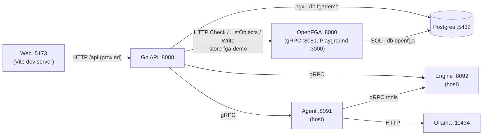

# Architecture

A multi-tenant authorization demo. A Go API owns users, tenants, documents, photos, blueprints, and project tasks; [OpenFGA](https://openfga.dev) makes every allow/deny decision; a React admin panel is the clickable proof. [README.md](README.md) tells the story and the click script.

This file is the system overview. Each part has its own:

- [api/ARCHITECTURE.md](api/ARCHITECTURE.md): the Go service, its layers, and how a request is authorized.
- [web/ARCHITECTURE.md](web/ARCHITECTURE.md): the React admin panel and how it shows permissions.
- [docs/](docs/): detailed reference (schema, model, tuples, routes, seed data, tests).

## System context



| Piece | Role |
| --- | --- |
| Web (`web/`) | Admin panel. Renders only what the API says the actor may do. |
| API (`api/`) | The only authenticated edge. Validates, asks OpenFGA, reads and writes Postgres. |
| Postgres `fgademo` | Display record: names, membership labels, file metadata, grant rows. Never decides access. |
| OpenFGA | Relationship tuples. Answers Check, BatchCheck, ListObjects. Allow-only model. |
| `agent/` | Python gRPC service (:8091) that owns every LLM call: a prompt becomes a JSON brief, a chat message becomes edit operations on a brief or a plan, a reviewer proposes fixes for failed checks, and the cost-estimation chat runs an interview, web price research and a reply. The model only proposes; the Agent calls the Engine's tools to validate and build. Stateless, no auth, never sees a tenant or user id: only the API calls it, after its Checks. See [agent/README.md](agent/README.md). |
| `blueprint-engine/` | Python gRPC service (:8092), deterministic, no LLM and no network: floor plans (layout, walls, openings, fixtures, rule checks), DXF import and patch, PDF and picture conversion, the DXF/SVG/PDF sheets and the IFC4 model, plan and brief operations, and the cost-estimation takeoff and pricing. Stateless, no auth: the API and the Agent call it. See [blueprint-engine/README.md](blueprint-engine/README.md). |
| `deploy/` | Docker Compose for Postgres and OpenFGA. The API, Engine, Agent, and Vite run on the host. |

## Core principles

1. **OpenFGA decides.** An action is allowed only after the OpenFGA check named in the [decision catalog](docs/decision-catalog.md) returns true. Collections use ListObjects, then a Postgres query for those ids only.
2. **Postgres only displays.** `tenant_members.role`, the derived affiliation (a member is internal iff their company is the tenant's own company), and `platform_admins` choose which tuple to write and which label to show. No code, Go or React, branches on them to permit anything.
3. **Identity is a user id, tenancy is a header.** The JWT `sub` is the user; the active tenant is `X-Tenant-ID`, because one person belongs to many tenants.
4. **Allow-only model.** No `but not` or conditions. "Private wins" is an intersection over the ancestor chain; entitlements are `user:*` wildcard tuples intersected into content checks. Content lives in projects (tenant -> project -> items); a member's permissions in a project are the union of tenant-role and project-role grants (internal members reach every project, external members need project membership). Custom roles are tenant-scoped `tenant_role` objects (and project-scoped `project_role` objects): a platform admin assigns permissions from a fixed catalog, and those grants are `role#assignee` usersets OR'd into the existing `can_*` relations. The four built-in affiliation roles stay.
5. **Fail closed.** Grants write Postgres then OpenFGA; revocations delete in OpenFGA then Postgres. A crash leaves less access, never more. No outbox, no workers.
6. **The UI is a mirror.** The API computes permissions with Check and returns them; the UI hides controls from that. Hiding is UX only; the API always checks.

## Authorization at a glance

Three layers of objects: `platform` (system admins), `tenant` (internal/external roles, product entitlements), and content (`folder`/`document`, `album`/`photo`) that inherits through containers, plus `blueprint`, which sits directly in a project with no public flag (externals reach it through a share or a custom-role `grant_*`, never through a public flag). Tasks (and their comments) are a separate domain authorized on the project (`can_view_tasks`, `can_edit_tasks`, `can_manage_tasks`); only a task comment is an OpenFGA object.

- Internal members see and edit all tenant content. External members see a container only when it and every ancestor are public, plus anything explicitly shared with them.
- The system admin manages tenants, users, products, and memberships but is not a tenant member and sees no content.
- Details: [authorization model](docs/authorization-model.md), [tuple catalog](docs/tuple-catalog.md).

## Request flow

```text
web  --Bearer JWT + X-Tenant-ID-->  handler  -->  usecase/service
                                                   |-- Authorizer.Check / ListObjects  --> OpenFGA
                                                   |-- repos (display rows)            --> Postgres
                                                   `-- WriteGuard (ordered tuple writes)
```

## Scope

In scope: ReBAC across platform, tenant, and resource layers; affiliation-based defaults; private/public containers; direct shares to external members; product entitlements; an admin panel that performs the README script.

Out of scope (do not scaffold): SSO or password flows beyond login, object storage and file serving (an uploaded PDF or picture is passed to the engine and discarded; only a DXF plan keeps its original (the uploaded DXF, the DXF converted from an uploaded PDF or picture, or the DXF the engine drew for a created plan), as a bytea row next to the version, downloadable by editors), cross-tenant shares, conditions or `but not`, an API to grant `system_admin`, deleting users or tenants, outbox or background workers, pagination, ownership transfer.

## Repository layout

```text
api/        Go service            -> api/ARCHITECTURE.md
web/        React admin panel     -> web/ARCHITECTURE.md
blueprint-engine/  Python floor-plan engine -> blueprint-engine/README.md
prds/       Proposals and plans (prds/plans/text2blueprint-poc.md)
deploy/     Docker Compose, Postgres init
docs/       Detailed reference
Makefile    compose-up, seed, api, web, test, test-integration
go.work     Lets the language server resolve api/ from the repo root
```

## Reference docs

| Doc | Contents |
| --- | --- |
| [docs/operations.md](docs/operations.md) | Runtime, Compose, environment variables |
| [docs/database-schema.md](docs/database-schema.md) | Postgres DDL |
| [docs/authorization-model.md](docs/authorization-model.md) | OpenFGA DSL, id format, store bootstrap |
| [docs/tuple-catalog.md](docs/tuple-catalog.md) | Tuples per command, write ordering and compensation |
| [docs/decision-catalog.md](docs/decision-catalog.md) | Required Check per action |
| [docs/http-api.md](docs/http-api.md) | Routes, errors, payloads |
| [docs/seed-data.md](docs/seed-data.md) | The fixed demo world |
| [docs/web-ui.md](docs/web-ui.md) | Page behavior and UI permission mapping |
| [docs/testing.md](docs/testing.md) | What the tests assert |

## Harness

Verification and session state: `make check` runs the static tier and `scripts/check-architecture.sh`; `make verify-live` runs the live tier. Progress, decisions, and checklists are in [docs/harness/](docs/harness/).
