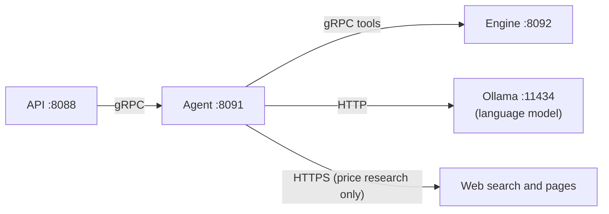

# Agent architecture

The Agent (`agent/`, gRPC :8091) owns every LLM call. It is stateless, has no auth and never sees a tenant or user id; only the API calls it, after its OpenFGA Checks. The model only *proposes* (a brief, edit operations, claims read from a message, search queries); the Engine's tools validate, repair and lay out, and code decides the flow. Contracts: `proto/fga/demo/agent/v1/agent.proto`, summary in `docs/service-contracts.md`. Run and env: `README.md`.



## Layers (dependencies point inward)

`domain/{model,gateway}` + `errors.py` -> `usecase/<op>.py` (+ `usecase/helper/`) -> `service/<op>.py` (+ `service/helper/`, `service/prompts/`) -> `infrastructure/<technology>/` (+ `infrastructure/entity/`) -> `handler/grpc/` (+ `mapper/`, `common/`). `wire.py` is the only composition root and `serve.py` the entry point. Rules and the "touch exactly these" checklist: CLAUDE.md and `.claude/skills/python-agent/SKILL.md`; `scripts/check-architecture-python.sh` and `scripts/check-python-shape.py` enforce what a script can.

## Operations

| RPC | Use case (service) | What it does |
| --- | --- | --- |
| `BriefFromText` | `BriefDrafter` | Model drafts a brief from the prompt (opt-in enhancer first); the Engine normalizes it. |
| `Revise` | `BriefReviser` | Model proposes ops for a chat message; the Engine applies and rebuilds; a refusal goes back to the model with the error, up to 3 attempts. Streams progress. |
| `RevisePlan` | `PlanReviser` | The same for an imported plan (no brief). |
| `Review` | `BriefReviewer` | Up to 3 rounds fixing failed checks; a round is kept only when the issue score drops. |
| `EstimateTurn` | `EstimateTurner` | One chat turn: `EstimateReader` (four narrow claim readings, grounded in the message) and `EstimateInterview` (slots decided by code) or, when the plan can be priced, `EstimatePricer` (`PriceResearcher` for the web) and `EstimateReplier` (reply from the figures only). Streams events; a 30 minute ceiling. |

## Boundaries

- The Engine is reached only through the typed `BlueprintEngine` gateway (`infrastructure/engine_grpc`); a test fails until every Engine RPC is used or deliberately left out.
- Streams: a refusal before the first message is a gRPC status with an `ErrorDetail`; after it, an in-band `Error` event (422, 502, 504 `timeout`, 500). `common/streaming_helper.py` runs a stream on a worker thread and cancels it when the client leaves (the progress callback raises `Cancelled`).
- The conversation state is opaque to the API (JSON, same shape as before the split); the API stores it and sends it back each turn.

## Estimate turn in detail

Served from `handler/grpc/blueprint_handler.py`: `BriefFromText` (unary) and the streams `Revise`, `RevisePlan` (plan kept as drawn) and `Review` (each: progress, then a result or an in-band error). `Revise` ends with one automatic review round when the edit introduced errors the plan did not have (`BriefReviewer`: forbidden ops, 15% area cap, a round kept only when the issue score drops). `EstimateTurn` (T13b, `handler/grpc/estimate_handler.py`) streams a turn of the estimate conversation (see below).

The estimate turn is built from these parts (T12, T13a, T13b), each a use case with its own service: `PriceResearcher` asks the model for search queries and prices read off pages, and code checks every price (quote on the page, unit and currency conversion, outliers, region pinned). It reaches the web only through the `WebSearch` and `WebPages` gateways (Brave, Serper, a robots-aware page reader, the invented `demo` list) and caches nothing.

`EstimateTurner` runs one turn: it reads the message, records what it states (an event per change), asks the next open question (code decides which) or measures the plan with the Engine and prices it, and writes the reply, streaming progress, facts, tokens, rates and the estimate. `EstimatePricer` uses the person's own rates first, then rates researched earlier for this region and quality (kept in the session), then the web for the rest (at most 40 per turn). An unchanged answer is never priced again (the session's fingerprint). `EstimateReplier` is given the figures it may say and never changes a number; when the model fails before any text the question or a fixed text is the reply, after some text the turn fails (an in-band 502). The turn has its own ceiling (`ESTIMATE_TURN_SECONDS`, default 1800; an in-band 504 `timeout`) and stops quietly when the caller leaves. Configuration (read by `wire.py`): `ESTIMATE_SEARCH_PROVIDER` (`brave`, `serper`, `demo`, `none`), `ESTIMATE_SEARCH_API_KEY`, `ESTIMATE_SEARCH_PARALLEL` (3), `ESTIMATE_USD_VND` (25000), `ESTIMATE_RULES` (`on`, `off` drops the keyword layer), `ESTIMATE_TURN_SECONDS`. Evals against the live model: `make agent-eval` (brief) and `make agent-eval-estimate` (reading, rules on and off), compared with `specs/re-architecture-system/baseline/`.

`EstimateReader` (the model reads one message as four claim lists, `{quote, field, value}`; `ClaimChecker` drops a claim whose quote is not in the message or whose value is invalid; `KeywordReader` adds what code reads with certainty and vetoes what the message cannot support) and `EstimateInterview` (the open questions in order, decided by code; what a message changes; the fingerprint of a session). The plan comes in as the Engine's typed `SummarizePlan` (`gateway.BlueprintEngine.summarize_plan`), asked with the session's facts, and the catalog (`rate_catalog`, `priced_fixtures`, `default_markups`) comes from the shared `DesignCatalogLoader`. A refusal before the first stream message is a gRPC status with an `ErrorDetail`; after it, an `Error` event.

## Layers in practice

```text
request -> handler -> usecase (interface) -> service -> gateway (interface) -> infrastructure -> Ollama, Engine, ...
```

`handler/grpc/` is the delivery layer: the `<domain>_handler.py` endpoint classes plus the delivery plumbing around them (`servicer.py`, `server.py` with health, `mapper/`, and `common/*_helper.py` for what the handlers share: `streaming_helper.py`, `error_helper.py`). It decodes, calls one use case and encodes; it never holds business rules and never imports a service or an adapter (`wire.py` injects them).

```text
fga_agent/
  wire.py, serve.py            composition root and entrypoint
  domain/   model/ gateway/ errors.py        business data, interfaces to the outside, domain errors
  usecase/  <op>.py  helper/                 one Protocol per operation (signatures only); shared business rules (design_catalog_loader, feedback_asker)
  service/  <op>.py  helper/  prompts/       <Op>Service implements the use case; shared rules; prompt functions
  infrastructure/  ollama/ engine_grpc/ entity/   one folder per technology; entity = their wire shapes
  handler/  grpc/ (<domain>_handler.py, common/ helpers, mapper/, servicer, server)   delivery layer
```

## Where things go

| Need | Put it in |
| --- | --- |
| A new outside dependency (the model, the Engine, price search, page fetch) | a Protocol in `domain/gateway/<collaborator>_gateway.py`, named for what the domain asks of it, one per file, re-exported in `__init__.py`; the adapter in `infrastructure/<technology>/` |
| A concept the services pass around | `domain/model/<concept>.py` (`brief`, `plan`, `plan_check`, `design_limits`, ...), stdlib only |
| A technology's wire shape (an Ollama request, a chunk) | `infrastructure/entity/<technology>_<shape>.py` |
| Converting protobuf DTOs | `handler/grpc/mapper/<model>_mapper.py` (Agent API: domain -> response, error -> status) or `infrastructure/engine_grpc/mapper/<model>_mapper.py` (Engine response -> domain) |
| A business operation | `usecase/<operation>.py` (interface, verb methods) + `service/<operation>.py` (`<Operation>Service`, the logic), wired in `wire.py` |
| A prompt | `service/prompts/<operation>.py`, pure functions; model-specific tuning stays in `infrastructure/ollama` |
| A new Engine operation | a method in `engine.proto`, a typed method on `gateway.BlueprintEngine`, and its `@rpc` adapter in `infrastructure/engine_grpc/blueprint_engine.py` (a test fails until every `EngineService` method is used or deliberately left out) |
| An RPC | a method of `handler/grpc/<domain>_handler.py` (with its own `<Domain>Usecases`): decode, call one use case with a `CallContext`, encode through `mapper/`; `servicer.py` only delegates; errors through `common/error_helper.py`, streams through `common/streaming_helper.py` |

Calls carry a `CallContext` (request id) and, for long runs, a progress callback (`Callable[[Progress], None]`) explicitly (it may raise `Cancelled`); there are no ambient `ContextVar`s.

Each layer keeps its own common code: a handler helper in `handler/grpc/common/`, a shared business rule as an interface in `usecase/helper/` implemented in `service/helper/`, an infrastructure helper inside `infrastructure/`; never in another layer (the harness checks this).
Mappers convert both ways (build/decode the request, encode/read the response). `scripts/check-architecture-python.sh` (with `scripts/check-python-shape.py`: thin handlers, small mappers, small functions) enforces the layer imports, one gateway per file, usecase/service pairs, no ambient state, prompts only in `service/`, dataclasses only in `domain/model/` and `infrastructure/entity/`, and protobuf DTOs only in `mapper/`.

Health (`grpc.health.v1`) is NOT_SERVING until the Engine's tool list and catalog have loaded.
