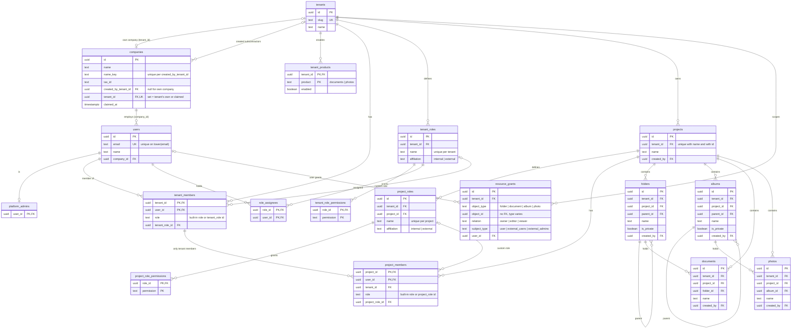

# Database schema

Postgres is the display record. Authorization never reads `tenant_members.role` or any company data. Overview: [api/ARCHITECTURE.md](../api/ARCHITECTURE.md). Migrations live in `api/migrations/`.

## Entity relationship diagram

Current schema after migration 00005. Columns are abbreviated to keys, foreign keys, and the fields that matter for authorization display. Composite foreign keys `(project_id, tenant_id)` and `(tenant_id, user_id)` are drawn as one relationship.



Affiliation is not stored on `tenant_members`: a member is internal iff `users.company_id` equals the tenant's own company (`companies.tenant_id`). Authorization still comes from OpenFGA, not from these rows.

## Postgres schema

Postgres is the display record and the membership label. Authorization reads do not use `tenant_members.role`.

This is the 00001 baseline; later migrations (below) rename and extend it. Apply it as `api/migrations/00001_init.sql` with goose `-- +goose Up` and a matching Down that drops tables in reverse dependency order.

```sql
CREATE TABLE users (
    id            uuid PRIMARY KEY,
    email         text NOT NULL UNIQUE,
    name          text NOT NULL,
    password_hash text NOT NULL,
    created_at    timestamptz NOT NULL DEFAULT now()
);

CREATE TABLE platform_admins (
    user_id    uuid PRIMARY KEY REFERENCES users (id),
    created_at timestamptz NOT NULL DEFAULT now()
);

CREATE TABLE tenants (
    id         uuid PRIMARY KEY,
    slug       text NOT NULL UNIQUE,
    name       text NOT NULL,
    created_at timestamptz NOT NULL DEFAULT now()
);

CREATE TABLE memberships (
    tenant_id   uuid NOT NULL REFERENCES tenants (id) ON DELETE CASCADE,
    user_id     uuid NOT NULL REFERENCES users (id) ON DELETE CASCADE,
    affiliation text NOT NULL CHECK (affiliation IN ('internal', 'external')),
    role        text NOT NULL,
    created_at  timestamptz NOT NULL DEFAULT now(),
    PRIMARY KEY (tenant_id, user_id),
    CHECK (
        (affiliation = 'internal' AND role IN ('internal_admin', 'internal_user'))
        OR (affiliation = 'external' AND role IN ('external_admin', 'external_user'))
    )
);
CREATE INDEX memberships_tenant_affiliation_idx
    ON memberships (tenant_id, affiliation);

CREATE TABLE tenant_products (
    tenant_id  uuid NOT NULL REFERENCES tenants (id) ON DELETE CASCADE,
    product    text NOT NULL CHECK (product IN ('documents', 'photos')),
    enabled    boolean NOT NULL DEFAULT false,
    updated_at timestamptz NOT NULL DEFAULT now(),
    PRIMARY KEY (tenant_id, product)
);

CREATE TABLE folders (
    id         uuid PRIMARY KEY,
    tenant_id  uuid NOT NULL REFERENCES tenants (id) ON DELETE CASCADE,
    parent_id  uuid REFERENCES folders (id) ON DELETE RESTRICT,
    name       text NOT NULL,
    created_by uuid NOT NULL REFERENCES users (id),
    created_at timestamptz NOT NULL DEFAULT now()
);
CREATE INDEX folders_tenant_id_idx ON folders (tenant_id);
CREATE INDEX folders_parent_id_idx ON folders (parent_id);

CREATE TABLE documents (
    id         uuid PRIMARY KEY,
    tenant_id  uuid NOT NULL REFERENCES tenants (id) ON DELETE CASCADE,
    folder_id  uuid NOT NULL REFERENCES folders (id) ON DELETE RESTRICT,
    name       text NOT NULL,
    mime_type  text NOT NULL,
    byte_size  bigint NOT NULL CHECK (byte_size >= 0),
    created_by uuid NOT NULL REFERENCES users (id),
    created_at timestamptz NOT NULL DEFAULT now()
);
CREATE INDEX documents_tenant_id_idx ON documents (tenant_id);
CREATE INDEX documents_folder_id_idx ON documents (folder_id);

CREATE TABLE albums (
    id         uuid PRIMARY KEY,
    tenant_id  uuid NOT NULL REFERENCES tenants (id) ON DELETE CASCADE,
    parent_id  uuid REFERENCES albums (id) ON DELETE RESTRICT,
    name       text NOT NULL,
    created_by uuid NOT NULL REFERENCES users (id),
    created_at timestamptz NOT NULL DEFAULT now()
);
CREATE INDEX albums_tenant_id_idx ON albums (tenant_id);
CREATE INDEX albums_parent_id_idx ON albums (parent_id);

CREATE TABLE photos (
    id         uuid PRIMARY KEY,
    tenant_id  uuid NOT NULL REFERENCES tenants (id) ON DELETE CASCADE,
    album_id   uuid NOT NULL REFERENCES albums (id) ON DELETE RESTRICT,
    name       text NOT NULL,
    mime_type  text NOT NULL,
    byte_size  bigint NOT NULL CHECK (byte_size >= 0),
    created_by uuid NOT NULL REFERENCES users (id),
    created_at timestamptz NOT NULL DEFAULT now()
);
CREATE INDEX photos_tenant_id_idx ON photos (tenant_id);
CREATE INDEX photos_album_id_idx ON photos (album_id);

CREATE TABLE resource_grants (
    id           uuid PRIMARY KEY,
    tenant_id    uuid NOT NULL REFERENCES tenants (id) ON DELETE CASCADE,
    object_type  text NOT NULL CHECK (object_type IN ('folder', 'document', 'album', 'photo')),
    object_id    uuid NOT NULL,
    relation     text NOT NULL CHECK (relation IN ('owner', 'editor', 'viewer')),
    subject_type text NOT NULL CHECK (subject_type IN ('user', 'internal_users', 'external_users', 'external_admins')),
    user_id      uuid REFERENCES users (id) ON DELETE CASCADE,
    created_at   timestamptz NOT NULL DEFAULT now(),
    CHECK (
        (subject_type = 'user' AND user_id IS NOT NULL)
        OR (subject_type = 'internal_users' AND user_id IS NULL AND relation IN ('viewer', 'editor'))
        OR (subject_type = 'external_users' AND user_id IS NULL AND relation = 'viewer')
        OR (subject_type = 'external_admins' AND user_id IS NULL AND relation IN ('viewer', 'editor'))
    )
);
CREATE UNIQUE INDEX resource_grants_user_uniq
    ON resource_grants (object_type, object_id, user_id)
    WHERE subject_type = 'user';
CREATE UNIQUE INDEX resource_grants_userset_uniq
    ON resource_grants (object_type, object_id, subject_type)
    WHERE subject_type <> 'user';
CREATE INDEX resource_grants_tenant_user_idx
    ON resource_grants (tenant_id, user_id);
```

`api/migrations/00002_container_privacy.sql` then adds `is_private boolean NOT NULL DEFAULT true` to `folders` and `albums`, and narrows `resource_grants.subject_type` to `user`, `external_users`, and `external_admins` (the `internal_users` group share is gone: internal members already see all content).

`api/migrations/00003_custom_roles.sql` adds tenant-scoped custom roles. `roles.name` is unique per tenant. `role_permissions.permission` is one of `view`, `edit`, `manage`, `change_visibility`, `contribute`, `create_private`, `manage_members`, `view_products`. `api/migrations/00004_role_affiliation.sql` adds `roles.affiliation` (`internal` or `external`) and `memberships.custom_role_id`. A member holds one role: a built-in role with `custom_role_id` null, or a custom role whose id is stored in both `role` and `custom_role_id`. These rows display the tuples; OpenFGA still decides.

## Companies, projects, and tenant/project roles (migration 00005)

Spec for `prds/update-tenant-structure.md`. `api/migrations/00005_companies_projects.sql` applies it to existing data (see Data migration) and the seed reseeds from scratch.

**Companies.** `companies(id, name, name_key, tax_id null, created_by_tenant_id null, tenant_id null unique, claimed_at null, created_at)`, unique on `(created_by_tenant_id, name_key)`.

- Every tenant owns exactly one company (`tenant_id` set), inserted by `TenantRepo.Create`. Its people are the internal members.
- A subcontractor a tenant creates on its behalf is an unclaimed company: `tenant_id` null, `created_by_tenant_id` = the creator. It is a display record with no tuples, not a tenant: it has no contract, admins, products, or roles.
- The same real company created by two tenants is two rows. A tenant cannot verify another tenant's data, and one shared editable row would leak or alter data across tenants. Duplicates are flagged (same name) for the platform admin and merged at claim.
- `users.company_id uuid NOT NULL`: one person, one account, one employer. Email stays unique, case-insensitively (`users_email_lower_uniq`). Add-member looks the email up first and reuses the account.

**Claim.** The platform admin has verified ownership out of band (SSO is a non-goal; for example a verified email at the company or a matching `tax_id`). `POST /tenants/:id/company-claims` merges the named unclaimed companies (the one other tenants created and confirmed duplicates) into the claiming tenant's own company in one transaction: users move to it, the unclaimed rows are deleted. Memberships in other tenants are untouched, so those users stay external there, nothing in OpenFGA changes, and the claiming tenant takes over the company and its people. The claim is a 409 when any of those users is already a member of the claiming tenant (their affiliation there would flip); remove them first.

**Affiliation is derived, not stored.** A member is internal iff `users.company_id` points at the tenant's own company; otherwise external. `memberships.affiliation` is dropped. Repos compute it (`affiliationExpr` in `membership_repo.go`) and the API still returns `affiliation` as a display label. OpenFGA still gets the `internal_*` or `external_*` relation chosen at add time. Bob is internal in Acme (his company) and external in Globex, one account.

**Renames.** `memberships` -> `tenant_members` (`custom_role_id` -> `tenant_role_id`, no `affiliation`), `roles` -> `tenant_roles`, `role_permissions` -> `tenant_role_permissions`. FGA type `role` -> `tenant_role`. Go entity and usecase names for tenant roles were kept (`Role`, `RoleLister`); project roles are `ProjectRole*`.

**Projects.** `projects(id, tenant_id, name, created_by, created_at)`, unique `(tenant_id, name)` and `(id, tenant_id)`. `folders`, `albums`, `documents`, `photos` get `project_id uuid NOT NULL` with composite FK `(project_id, tenant_id) -> projects (id, tenant_id)`, so content cannot sit in another tenant's project. `tenant_id` stays on content for the `tenant_id = $1 AND id = ANY($2)` rule.

**Project roles and members.**

- `project_roles(id, tenant_id, project_id, name, affiliation)`, unique `(project_id, name)`: same shape as tenant roles but scoped to one project. `project_role_permissions(role_id, permission)` uses the same catalog.
- `project_members(project_id, tenant_id, user_id, role, project_role_id null, created_at)`, PK `(project_id, user_id)`. FK `(tenant_id, user_id) -> tenant_members` (only tenant members, and removing the tenant membership cascades), FK `(project_id, tenant_id) -> projects`. `role` is a built-in role name, or the project role id when `project_role_id` is set (CHECK).
- Role-type rule, for tenant and project assignment alike: an internal role goes only to an internal member, an external role only to an external member. The service checks the role against the member's derived affiliation (`CheckAffiliationRole`, and the custom role's `affiliation`), answering 400 `affiliation_role_mismatch`.

**Effective permissions** in a project are the union of the tenant role's and the project role's grants, evaluated by OpenFGA (see the authorization model). A tenant member who is not a project member: internal members keep tenant-wide access; external members get nothing in that project (open requirement, decided as this default).

**Data migration.** One company per tenant; `users.company_id` = the company of the tenant where the user is internal; external members with no company join a placeholder "Unassigned external (<tenant>)" company per tenant that the tenant admin can rename; everyone else (platform admins) joins a "Platform" company. Each tenant gets a default project "General" that receives all existing containers and content. Role tables are renamed in place. No project members are created, so existing external members must be added to a project; re-run `make seed` for the demo.

`resource_grants` includes owners. A group share cannot use `user_id`. `external_users` maps to `tenant:<id>#external_user` and is viewer only, because an external user cannot upload. `external_admins` maps to `tenant:<id>#external_admin`. One group row per object and subject type; changing viewer to editor replaces that row.

`is_private` is the display flag. The `public` tuple is the authorization record (see the tuple catalog).

`created_by` is a display field. The owner tuple is the authorization record. They can diverge after a member is removed: the row keeps `created_by`, and the owner tuple is deleted.

There is no foreign key from `resource_grants.object_id` to a single table because the object type varies. The content repo writes the owner grant in the same transaction as the object and deletes grants when the object is deleted.

