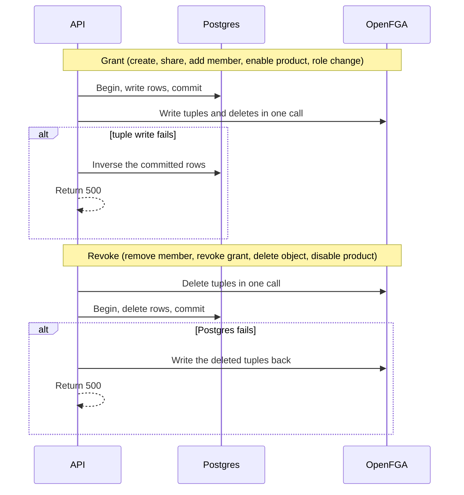

# Tuple catalog and write path

Which tuples each domain command writes, and how Postgres and OpenFGA writes are ordered. Builders live in `api/internal/infrastructure/fga`.

## Tuple catalog

Pure relation builders in `api/internal/infrastructure/fga` build these slices, one per domain (`MembershipRelations`, `RoleRelations`, `ProductRelations`, `FolderRelations`, `DocumentRelations`, `AlbumRelations`, `PhotoRelations`), reached through the `*RelationGateway` interfaces. Services persist Postgres, then hand the tuples to `helper.WriteGuard`. Unit tests cover the builders without a server.

Notation: `user:U`, `tenant:T`, `role:R`, `folder:F`, `document:D`, `album:A`, `photo:P`.

#### Platform admin seed

Write `platform:main#system_admin@user:U`. The demo has no HTTP command for this. Only the seed writes it, and it also inserts `platform_admins`.

#### Create user

No tuple. A user is an identity until some command relates them to an object.

#### Create tenant

Insert `tenants`. Insert `tenant_products` rows for `documents` and `photos`, both `enabled = false`. No tuples. Products start disabled, which means the wildcard tuples are absent.

#### Set product

Check is in the decision catalog. Then:

- Enabled documents: write `tenant:T#documents_enabled@user:*` and set `tenant_products.enabled = true`.
- Disabled documents: delete `tenant:T#documents_enabled@user:*` and set `enabled = false`.
- Photos uses relation `photos_enabled`.

Write the wildcard only. Do not write `documents_enabled` for a concrete user. Do not delete content tuples.

#### Assign role

The body carries `affiliation` and `role` on create. A role change carries `role` only. Legal pairs:

| Affiliation | Roles |
| --- | --- |
| internal | `internal_admin`, `internal_user` |
| external | `external_admin`, `external_user` |

Any other pair is 400 `affiliation_role_mismatch`. On update, the new role must belong to the membership's existing affiliation. Affiliation is immutable. Changing it means delete the membership and create it again.

One OpenFGA Write. Write the new role tuple and delete the other three role tuples so a person has one direct role relation. The authz gateway ignores missing deletes, so the command does not need to know which tuple existed before:

| New role | Write | Delete |
| --- | --- | --- |
| `internal_admin` | `tenant:T#internal_admin@user:U` | `internal_user`, `external_admin`, `external_user` on `tenant:T` for `user:U` |
| `internal_user` | `tenant:T#internal_user@user:U` | `internal_admin`, `external_admin`, `external_user` |
| `external_admin` | `tenant:T#external_admin@user:U` | `external_user`, `internal_admin`, `internal_user` |
| `external_user` | `tenant:T#external_user@user:U` | `external_admin`, `internal_admin`, `internal_user` |

Do not also write the implied relation. `internal_admin` already satisfies `internal_user`, and `external_admin` already satisfies `external_user`.

Upsert `memberships.affiliation` and `memberships.role` on create. Update `role` only on change.

Reject the change with 409 when it would leave the tenant with zero rows where `role = internal_admin`. External admins do not count. That count is a stored invariant, not an authorization check.

#### Remove member

Load the membership and the user's `resource_grants` rows for that tenant. One OpenFGA Write deletes the tuples below. Then one Postgres transaction deletes those grant rows and the `memberships` row. Revocations go to OpenFGA first, so a failure between the two steps leaves less access, not more. The tuples are:

- `tenant:T#internal_admin@user:U`, `tenant:T#internal_user@user:U`, `tenant:T#external_admin@user:U`, and `tenant:T#external_user@user:U` (the authz gateway ignores the three that do not exist)
- every direct grant: `folder|document|album|photo:<id>#<relation>@user:U`

Do not delete tuples whose user is `tenant:T#external_user` or `tenant:T#external_admin`, nor `root`/`public` markers.

The same last-internal-admin 409 applies.

Also delete each `role:R#assignee@user:U` for custom roles in this tenant that name the user, and delete the matching `role_assignees` rows in the same Postgres transaction as the membership. Do not delete the role itself or its `grant_*` tuples; other assignees keep them.

#### Custom roles

Check is `can_manage_platform` for create, rename, permissions, and delete. List and get are also allowed by `can_manage_members`. The four built-in roles are not rows in `roles`. Affiliation is `internal` or `external` and does not change.

Create writes two tuples and inserts `roles`:

- `role:R#tenant@tenant:T`
- `tenant:T#internal_role@role:R` or `tenant:T#external_role@role:R`

Rename updates `roles.name` only.

Set permissions replaces `role_permissions`. For each removed permission, delete `tenant:T#grant_<permission>@role:R#assignee` in OpenFGA first, then delete the row. For each added permission, insert the row, then write that tuple. Do not write the implied permissions. The relation names are `grant_view`, `grant_edit`, `grant_manage`, `grant_change_visibility`, `grant_contribute`, `grant_create_private`, `grant_manage_members`, and `grant_view_products`.

Assigning the role to a member is the member add or role-change command. It writes `role:R#assignee@user:U`, deletes the four built-in role tuples, and sets `memberships.custom_role_id`. Switching back to a built-in role deletes the assignee tuple and writes the built-in tuple. One person holds one role.

Delete role is refused with 409 while a membership still points at it. Otherwise it deletes the anchor and grant tuples in OpenFGA first, then the `roles` row. Permissions cascade.

#### Create folder

Body carries `is_private` (required). Insert `folders` (with `is_private`) and an owner `resource_grants` row (`subject_type=user`, `relation=owner`). Tuples:

- `folder:F#tenant@tenant:T`
- `folder:F#owner@user:actor`
- `folder:F#parent@folder:parent` when `parent_id` is set, otherwise `folder:F#root@tenant:T`
- `folder:F#public@tenant:T` when `is_private` is false

Creating an album is the same with type `album`.

#### Set visibility

`PUT …/visibility {is_private}`. Check `can_change_visibility`. Making a container public writes `folder:F#public@tenant:T` and sets `is_private = false` (a grant: Postgres first). Making it private deletes that tuple (a revoke: OpenFGA first). No other tuple changes; descendants follow automatically through the ancestor chain.

#### Create document

Insert `documents` and an owner grant. Tuples:

- `document:D#tenant@tenant:T`
- `document:D#folder@folder:F`
- `document:D#owner@user:actor`

Creating a photo is the same with `photo:P#album@album:A`.

The creator becomes the owner. Do not also write `editor` or `viewer` for the creator. Those are implied.

#### Share

Body `{relation, subject, user_id?}`. `relation` is `viewer` or `editor`. `subject` is `user`, `external_users`, or `external_admins`. `user_id` is required when `subject` is `user` and must be absent otherwise.

Specific user:

- Insert or replace the user grant. The unique index allows one relation per user per object. When the user already has the other relation, delete the old tuple and write the new one in the same Write, and update the row.
- User tuple: `<objectType>:<id>#viewer@user:U` or `#editor@user:U`.

Affiliation userset:

| Subject | Relation | Tuple user |
| --- | --- | --- |
| `external_users` | `viewer` only | `tenant:T#external_user` |
| `external_admins` | `viewer` or `editor` | `tenant:T#external_admin` |

When the subject already holds the other relation on that object, the same Write deletes the old tuple and writes the new one, and the row is updated.

Insert or replace the userset grant for that subject type. Reject `editor` with subject `external_users` with 400 `cannot_upload`.

Reject `owner` with 400. Reject a grant that would change or remove the owner row with 400.

Before a user grant, Check `can_read_tenant` for the target user on `T`. A false result is 400 `not_a_member`. An editor grant also Checks `can_contribute` for the target. A false result is 400 `cannot_upload`. An external user fails `can_contribute`, so they cannot be granted editor. Userset grants have no target user.

#### Revoke grant

Body is the share shape. Delete the matching tuple, then the matching `resource_grants` row. Revoke of an owner row is 400. A missing grant is 404.

#### Delete document or photo

Check `can_delete`. Read every tuple for that object, delete them in one Write, then delete the grants and the row in one Postgres transaction. If Postgres fails, write the tuples back.

#### Delete folder or album

Return 409 when any child folder, document, child album, or photo still references it. Otherwise delete the object's tuples, then its grants and row, as for a document.

#### Rename

Update `name` in Postgres. No tuple change. Folders and albums require `can_manage`. Documents and photos require `can_edit`.

## Write path and compensation

The order depends on whether the command adds or removes access. Either way, a crash between the two stores leaves less access than intended, never more.

There is no outbox. A crash between the two steps can leave a display row with no matching tuple. That is fail-closed. Say so in the 500 log. The operator reruns the action (tuple writes are idempotent) or reruns `cmd/seed`. Do not build a repair daemon.

A role change is treated as a grant. It writes the new role tuple and deletes the others in one Write, so there is no moment with zero or two roles.

Compensation:

- Insert: delete the rows this command inserted.
- Role change: restore the previous `memberships` row.
- Enable product: restore `enabled = false`.
- Revoke commands: write back the tuples that were deleted.

If compensation itself fails, log both errors and still return 500.

