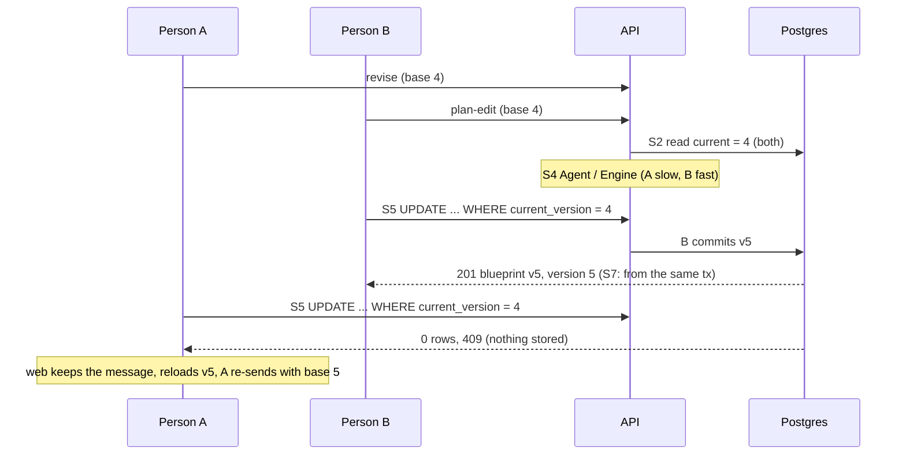

# Task blueprint_concurrent_edits: one response per write, and a real-Postgres test for the version guard

Feature: none (independent task) | Plan row: blueprint_concurrent_edits | Deployable: api/ | Endpoint: every versioned blueprint write (revise, revise/stream, reviews, brief, plan-edits, convert, restore) | Est: 3 h
Status: reviewed (task-reviewer round 1: accept, 3 nits fixed; authz-reviewer: accept, no findings)
Parent docs read (independent task: the source, a prompt): "two people edit the same blueprint at once (chat revise, plan edit, restore): can an edit be lost, can the version history or the response be wrong, what does the contract say". No parent specs. Read: `docs/http-api.md` (409 and the base_version paragraph), `CLAUDE.md` (blueprints), the 7 services above, `blueprint_helper.go`, `postgres/blueprint_repo.go`, migration 00006, `web/src/pages/BlueprintDetail.tsx`.

## 0. Findings (the answer to the question)

What the existing contract says (`docs/http-api.md:249`, `CLAUDE.md`, the `go-api` skill; `api/ARCHITECTURE.md` had a blueprint item about it, removed in this change because it is feature detail, not architecture): every versioned write sends `base_version`; it must equal the current version or the request is 409 `conflict` and nothing is written; the Check and the version test run before the Agent/Engine; the one write comes after. It says nothing about two writers racing between the test and the write, about the response body, or about delete/rename.

What the code does:

| # | Question | Verdict | Where |
| --- | --- | --- | --- |
| F1 | Can two writers overwrite each other (lost update)? | **No.** `AppendVersion` and `AppendVersionWithOriginal` run `UPDATE blueprints SET current_version = base+1 WHERE id = $1 AND current_version = base` and the `INSERT` of the version row in one transaction (`blueprint_repo.go:190`, `:204`). Under READ COMMITTED the second writer waits for the row lock, re-evaluates the `WHERE`, gets 0 rows and receives 409. `PRIMARY KEY (blueprint_id, version)` is a second backstop. The check in `loadBlueprintForEdit` is only an early exit; the guard is the SQL. | all 7 writers go through these two methods |
| F2 | Is the version history ever wrong (gap, duplicate, fork)? | **No.** The version number is `base+1`, taken under the row lock, so history is contiguous and each number has one writer. Restore copies an old row into a new number; it never rewrites history. | same |
| F3 | Can the **response** be wrong? | **Yes, rare.** After the commit `appendBlueprintVersion` (`blueprint_helper.go:127`) and `Convert` (`blueprint_plan_converter.go:52`) do `Get(blueprint)` then `GetVersion(base+1)` as two reads outside the transaction. If a third person commits between the commit and the `Get`, the body has `blueprint.current_version = N+2` next to `version.version = N+1`, and the caller never saw the N+2 content. An API client that takes the next `base_version` from `current_version` then writes on top of changes it never saw (the guard passes, so it is an unseen overwrite, not a lost row). The web page is safe: `write()` always calls `load()` and takes `base` from the fresh read. | `blueprint_helper.go:127-137`, `blueprint_plan_converter.go:52-60` |
| F4 | Does the loser waste work? | Yes, by design. A 409 from the SQL arrives after the Agent/Engine call (20 s or more for a chat revise on the local model). Nothing is stored; the web keeps the typed message (`setMessage("")` only on success) and reloads. Accepted: a lock held across an LLM call is worse. | `blueprint_reviser.go`, `blueprint_revise_streamer.go` |
| F5 | Delete racing a write | The write's `UPDATE` matches 0 rows, so the caller gets 409 "changed since version N", and the reload then says 404. Cascade removes the versions. Not a data problem; the status is misleading. Accepted. | `blueprint_repo.go:139`, `:190` |
| F6 | Rename racing a write | `Rename` updates `name` only, not `current_version`: last writer wins on the name, no version, no 409. By design (names are not history). | `blueprint_repo.go:132` |
| F7 | Chat history read | `chatHistory` runs after the stale test, in a separate read. A version committed in between can add its message to the history sent to the Agent, but then the final write fails with 409, so no wrong version is stored. Harmless. | `blueprint_helper.go:117,164` |
| F8 | Grant revoked while the LLM runs | The `can_edit` Check ran before the call; the write is not re-Checked. Existing, documented ordering ("Check before the engine"), not changed here. Out of scope. | all writers |
| F9 | Test gap | The guard is exercised only against `fakeBlueprints` in `service/*_test.go`; no real-Postgres test runs two writers (the repo has such tests only for products and tasks). So F1 and F2 are true by reading the SQL and not asserted by any test. | `postgres/*_integration_test.go` |

Baseline: the `make check` failure at `scripts/test-git-guard.sh` seen on `main` is only because the guard test runs on `main`; on the task branch it passes. TLC ran after the baseline check (see the TLA+ section).

## 1. Task
Make the response of a versioned write describe exactly the write it made (F3) and assert the version guard against real Postgres (F9). Nothing else changes: F4-F8 are accepted and written down in the docs. Deployable: `api/` only. Definition of done: S7 implemented, the tests in section 5 pass, `make check` (modulo the git-guard baseline failure) and `make verify-live` green, `docs/http-api.md` says what a 409 and a response guarantee.

## 2. Business logic

Unchanged (what must stay identical): S1-S6 below, the statuses (400/403/404/409), the Check-before-engine order, the single write, the 409 text, and the JSON shape of every response.

- S1: validate input (`message` 1-2000, `ops` JSON object, brief), `base_version >= 1` -> 400.
- S2: load the blueprint in the header tenant (404), `can_edit` Check (403), `base_version == current_version` else 409 (early exit only).
- S3: read the current version row (immutable once written) and, for chat, the last 6 messages.
- S4: call the Agent or Engine (nothing stored); a failure or an unbuilt outcome is 502/400 and writes nothing.
- S5: write: one transaction, `UPDATE blueprints SET current_version = base+1 WHERE id AND current_version = base`; 0 rows -> 409 `conflict`; else `INSERT` the version row (and the original file for `convert`). This is the only guard against a concurrent writer.
- S6 (today): after the commit, read the blueprint and then version `base+1` in separate statements and return them.
- **S7 (changed, replaces S6)**: the write returns what it wrote. `AppendVersion` and `AppendVersionWithOriginal` return `(model.Blueprint, model.BlueprintVersion, error)`, taken inside the transaction (`UPDATE ... RETURNING` the blueprint columns, `INSERT ... RETURNING created_at`). `appendBlueprintVersion` and `Convert` stop calling `Get` and `GetVersion`. The response therefore always has `blueprint.current_version == version.version == base+1`; a later writer is seen by the client on its next load, never mixed into this body. Pass the blueprint's other fields (`updated_at`, source fields) through the same `RETURNING` so the JSON shape does not change.
- S8: 409 and the response guarantee are written into `docs/http-api.md` (a client reloads, re-applies its change and resends with the new `base_version`; a response is the state right after this write).

### TLA+ model
`blueprint_concurrent_edits.tla` + `.cfg` next to this file; **model-checked: yes** (TLC 2.19, openjdk 25.0.2, 2 processes, MaxV 3, run 2026-11-22; `scripts/check-tla.sh` with `TLA2TOOLS_JAR` set and the brew JDK on PATH).
Variables -> repo: `cur` = `blueprints.current_version`; `hist` = `blueprint_versions.version` rows; `base` = the `base_version` a request read in S2; `wrote` = the version it inserted; `resp` = (`current_version`, `version.version`) in the response.

Granularity: `Commit` is one transaction (S5). `Respond` (S6 today) is its own action because it is separate statements outside the transaction.

Naive model first (`FIXED = FALSE`): TLC reports `Invariant RespConsistent is violated` after 40 states (32 distinct, depth 6). Trace: p1 Load (base 1); p1 Commit (cur 2, wrote 2); p2 Load (base 2); p2 Commit (cur 3, wrote 3); p1 Respond reads cur 3 with its own version 2, so `resp[p1] = <<3, 2>>`. `HistContiguous`, `OneWriterPerVersion` and `WriteFromBase` are not violated in that run (F1, F2). The control that removes it: S7, the response is returned by the write's own transaction, in `postgres/blueprint_repo.go`. Fixed model (`FIXED = TRUE`, the committed `.cfg`): `Model checking completed. No error has been found.` (29 states, 23 distinct, depth 5, exit 0). The trace is the regression test `TestBlueprintAppendVersionResponseIsFromTheWrite`.

Atomicity map:
| Action | Code unit that makes it atomic | Step |
| --- | --- | --- |
| Load | not atomic: `Get` then `GetVersion`; safe because a version row is immutable and the guard is S5 | S2, S3 |
| Commit | one transaction (`inTx`): conditional `UPDATE` + `INSERT` (+ original) | S5 |
| Respond (today) | not atomic: two reads after the commit | S6 |
| Respond (fixed) | part of Commit: `RETURNING` in the same transaction | S7 |
| Crash (Agent/Engine error, client gone, process dies before S5) | nothing was written; the transaction never starts | S4 |

Guard map:
| Action | Guard and where it lives |
| --- | --- |
| Load | `can_edit` Check (`authz.Require`), tenant match, `base_version == current_version` (`if` in `loadBlueprintForEdit`) |
| Commit | SQL `WHERE id = $1 AND current_version = $2` (`blueprint_repo.go`); PK `(blueprint_id, version)` |
| Respond | none; it only reads |
| Crash | n/a |

Invariant map:
| Invariant | Test (name) |
| --- | --- |
| HistContiguous, OneWriterPerVersion, WriteFromBase | `TestBlueprintAppendVersionConcurrentWritersOneWins` (real Postgres, integration tag): 8 goroutines call `AppendVersion` with the same base; exactly 1 returns nil, 7 return `ErrConflict`; `ListVersions` is `1..base+1` with no duplicate; the version row is the winner's |
| same, for convert (written) | `TestBlueprintAppendVersionWithOriginalConcurrentWritersOneWins` (one original row, only for the winner's version) |
| RespConsistent | `TestBlueprintAppendVersionResponseIsFromTheWrite` (real Postgres): 6 writers retry on 409; every returned blueprint and version agree (`current_version == version.version`, the writer's own row, no version twice). It is a stress test: it cannot be forced to fail deterministically against a re-reading implementation. The deterministic half of the naive counterexample is the unit test `TestReviseAnswersWithTheWrittenVersionNotAReRead` below |
| each failure action | nothing stored on an Agent/Engine error (exists: `TestReviseImportedWritesNothingOnEngineError`); a stale base never reaches the engine (exists: `TestReviseDeniedOrStaleNeverReachesTheEngine`); keep both |
| the returned rows equal what `Get`/`GetVersion` return | `TestBlueprintAppendVersionReturnsTheStoredRows` (added during implementation: the JSON shape must not change) |
| service uses the write's result, not a re-read | `TestReviseAnswersWithTheWrittenVersionNotAReRead` (unit; fails on the old code because the fake `Get` always says version 1) |
| delete vs write (F5) | `TestBlueprintAppendVersionAfterDeleteIsConflict` (documents the accepted 409) |

## 3. Impact
| Endpoint / page | Table / caller | Change | Must stay the same | Proof |
| --- | --- | --- | --- | --- |
| `POST /blueprints/:id/revisions`, `/revisions/stream`, `/reviews`, `PUT /brief`, `/plan-edits`, `/versions/:v/restore` | `blueprints`, `blueprint_versions`; `appendBlueprintVersion` | response built from the write (S7), no post-commit reads | statuses, JSON fields and values for a non-racing request, 409 text, write order, Check-before-engine | `scripts/smoke-replay.sh` and `smoke-replay-domains.sh` identical to the baselines; unit tests with the changed gateway |
| `POST /blueprints/:id/convert` | also `blueprint_originals`; `blueprintPlanConverter` | same | one transaction for version + original | the two new real-Postgres tests |
| `blueprint_gateway.go` (`AppendVersion`, `AppendVersionWithOriginal`) | `BlueprintRepo`, `fakeBlueprints` in tests | return the written blueprint and version | param count (still <= 3 after ctx) | `make check` (shape checks), `go vet -tags=integration` |
| Web `BlueprintDetail.tsx` | `write()` -> `load()` | none | it already reloads after every write and every 409 | `npm run build`; no web change |
| `docs/http-api.md` | docs | S8 wording (the mechanism and the guarantee live here; `api/ARCHITECTURE.md` item 6 (blueprints) is removed: feature detail, not architecture) | | read |

## 4. Risk
- Merge safety: additive inside one service; no migration, no model change, no new route. Rollback: revert the change.
- Authorization: unchanged (Check first, no new path). F8 (revoke during the LLM call) stays as documented.
- Data: none; the same two statements in the same transaction, plus `RETURNING`.
- Concurrency: S5 is already correct; the change only moves the response inside the transaction. Do not add `SELECT ... FOR UPDATE` across the LLM call.
- Compatibility: JSON shape identical; old and new builds can run together (same SQL guard).
- Out of scope: holding a lock or lease while the LLM runs (F4); 404 instead of 409 after a delete (F5); versioning renames (F6); re-Checking on write (F8); merging the two people's edits; the `make check` git-guard baseline failure.

## 5. Tests
- Unit: update `fakeBlueprints` for the new return values; assert `appendBlueprintVersion` returns the gateway's blueprint without calling `Get`/`GetVersion` again.
- Integration (real Postgres, `-tags=integration`): the five real-Postgres tests in the invariant map, using a pool as `product_repo_integration_test.go` does.
- E2E through the real entry point: with the API and Engine up, fire two `plan-edits` requests (same `base_version`) at an imported blueprint with `curl &`: one 201, one 409, `GET .../versions` shows exactly one new version; then two sequential edits by different users: each response has `current_version == version.version`.
- Commands: `make check`, `cd api && go vet -tags=integration ./... && make test-integration`, `scripts/check-tla.sh specs/_adhoc/20261122/blueprint_concurrent_edits.tla` (finds the brew JDK and `~/.local/share/tla/tla2tools.jar` itself).

## Questions answered (only what the parent docs did not)
- Scope: the user asked for an investigation and the contract only. Defaults chosen: F4-F8 accepted, not fixed; one deployable (`api/`).
- Open for the user: (1) implement S7 and the tests, or only the tests (F3 is rare and the web is safe)? (2) save the contract in git (a local save, no push)?

## Implementation notes (changes to the plan above, written here as the skill requires)
- Gateway: `AppendVersion` and `AppendVersionWithOriginal` return `(model.Blueprint, model.BlueprintVersion, error)`; the repo builds both from `UPDATE ... RETURNING` and `INSERT ... RETURNING` in the transaction, through shared `scanBlueprint` / `scanBlueprintVersion` so they read exactly like `Get` and `GetVersion`.
- `appendBlueprintVersion` no longer takes the blueprint; the services that only needed it for that call drop it.
- Harness changes needed to carry this contract: `scripts/check-specs.sh` now allows `<slug>.tla` and `<slug>.cfg` in `specs/_adhoc/<yyyymmdd>/` (it rejected them; the build-task skill already asks for them there), the skill text says so, and `scripts/check-tla.sh` finds the brew JDK and `~/.local/share/tla/tla2tools.jar` itself.
- Evidence: `make check` green (one earlier run had a timing-flaky Agent test, `test_a_client_that_leaves_stops_the_run_at_its_next_step`, which passed 3 times alone and on the re-run; no `agent/` change); the five new real-Postgres tests pass with `-race`; e2e through the new API: two `plan-edits` on the same `base_version` gave 201 and 409, history `[1, 2]`, and sequential writes plus a restore answered with `current_version == version.version`; `smoke-replay.sh` identical to the baseline; `smoke-replay-domains.sh` differs only by added task-permission keys (earlier merged work). Not run: `make verify-live` (no authorization change; it resets data), the naive regression test against the old repo (the signature changed, so it cannot compile against it).
