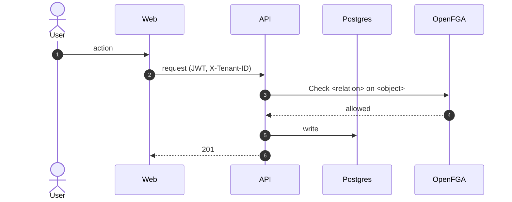
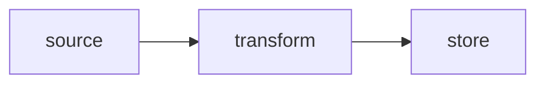

# System design: <feature>

## Components changed
| Component | Change (create / update / delete) | Why |
| --- | --- | --- |
| api | | |
| web | | |
| blueprint-engine | | |
| OpenFGA model / tuples | | |
| infra / 3rd party | | |

## Sequence diagram
Communication between services and infrastructure only, not business logic. Participants are real names (handler, usecase service, Postgres, OpenFGA, engine). Include the authorization Check and the failure/alt paths that change behavior.

## Data flow

## Authorization
New or changed actions (add to `docs/decision-catalog.md`), model/tuple changes (`docs/authorization-model.md`, `docs/tuple-catalog.md`), invariants touched.

## API contract
Routes, request/response, status codes (`docs/http-api.md`).

## Docs to update in the same change
-

## Risks and alternatives rejected
-
