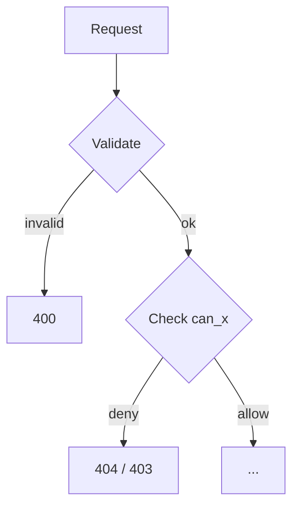

# Task <ID>: <title>

Feature: <feature> | Plan row: <ID> | Deployable: <api/web/agent/blueprint-engine/infra> | Endpoint: <route/RPC/page/job> | Est: <h>
Status: draft / approved / implemented / reviewed
Parent docs read: requirements <ok>, system-design <section>, db-design <section or n/a>, plan <row>

## 1. Task
What changes and why (2-4 sentences). Definition of done (checkable).

## 2. Business logic
New code: the whole flow, step by step. Changed code: before -> after, plus what must stay identical.

1. <validate input -> 400 ...>
2. <Check (decision catalog) -> 404 / 403 ...>
3. <read / call Engine or Agent / write ...>
4. <errors and their statuses>

## 3. Impact
| Endpoint / RPC / page / feature | Table / caller | Change | Must stay the same | Proof |
| --- | --- | --- | --- | --- |
| | | | | |

## 4. Risk
- Merge safety (from plan.md): <dark / additive / flag off>; rollback: <how>
- Authorization / data / concurrency / old-and-new build compatibility:
- Out of scope:

## 5. Tests
- Unit:
- Integration:
- E2E through the real entry point (from plan.md):
- Commands: `make check`, <others>

## Questions answered (only what the parent docs did not)
