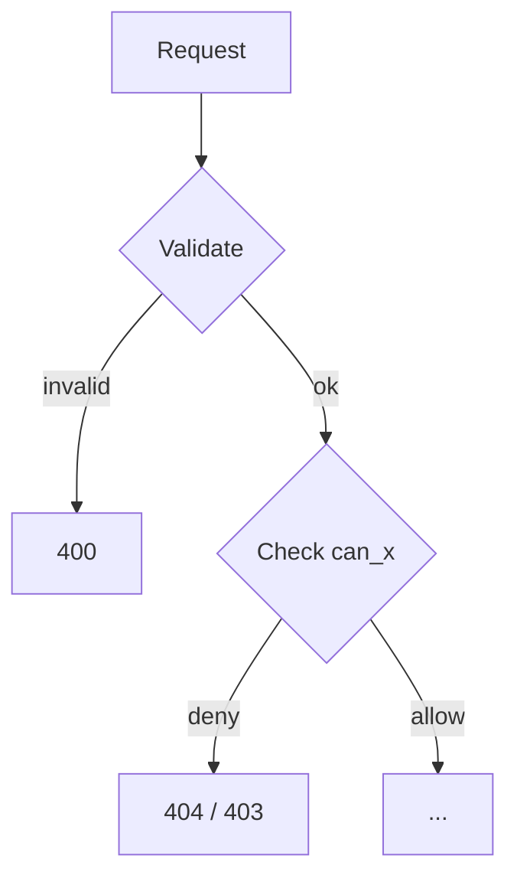

# Task <ID>: <title>

Feature: <feature, or none for an independent task> | Plan row: <ID, or slug> | Deployable: <api/web/agent/blueprint-engine/infra> | Endpoint: <route/RPC/page/job> | Est: <h>
Status: draft / approved / implemented / reviewed
Parent docs read (independent task: the source, prompt / file / url): requirements <ok>, system-design <section>, db-design <section or n/a>, plan <row>

## 1. Task
What changes and why (2-4 sentences). Definition of done (checkable).

## 2. Business logic
New code: the whole flow, step by step. Changed code: before -> after, plus what must stay identical.

Step IDs are append-only: never renumber; a removed step is marked `retired`, its number is not reused.

- S1: <validate input -> 400 ...>
- S2: <Check (decision catalog) -> 404 / 403 ...>
- S3: <read / call Engine or Agent / write ...>
- S4: <errors and their statuses>



### TLA+ model
`n/a: <reason>` for a plain read/CRUD slice. Otherwise `<ID>.tla` + `<ID>.cfg` next to this file; model-checked: yes / no (<why>).
Variables -> repo: <var = table / tuple / cache>

Granularity: each action is one atomic unit in the code. Code that reads then writes with no lock or transaction is two actions.

Naive model first: <what TLC found on the naive version (invariant broken + short trace), or `none, the model is too weak: fix it`>. The control that removes it: <unique index / ON CONFLICT / SELECT FOR UPDATE / WHERE version = base_version / idempotency key, and where>.

```tla
---- MODULE T0 ----
\* abstract actions from the steps above, incl. failure and concurrent actions
====
```

Atomicity map (one row per action; failure actions too):
| Action | Code unit that makes it atomic (one SQL statement / one transaction / one FGA call / not atomic) | Step |
| --- | --- | --- |
| | | |

Guard map (each action's enabling condition):
| Action | Guard and where it lives (`if` / SQL `WHERE`) |
| --- | --- |
| | |

Invariant map:
| Invariant | Test (name). A race invariant is a real-Postgres concurrency test; the naive counterexample is a regression test; each failure action has a fault-injection test |
| --- | --- |
| | |

## 3. Impact
| Endpoint / RPC / page / feature | Table / caller | Change | Must stay the same | Proof |
| --- | --- | --- | --- | --- |
| | | | | |

## 4. Risk
- Merge safety (from plan.md): <dark / additive / flag off>; rollback: <how>
- Authorization / data / concurrency / old-and-new build compatibility:
- Out of scope:

## 5. Tests
- Unit:
- Integration:
- E2E through the real entry point (from plan.md):
- Commands: `make check`, <others>

## Questions answered (only what the parent docs did not)
