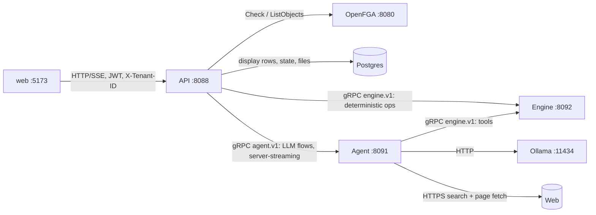
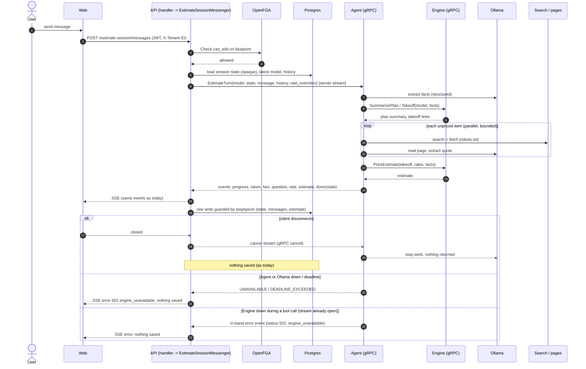
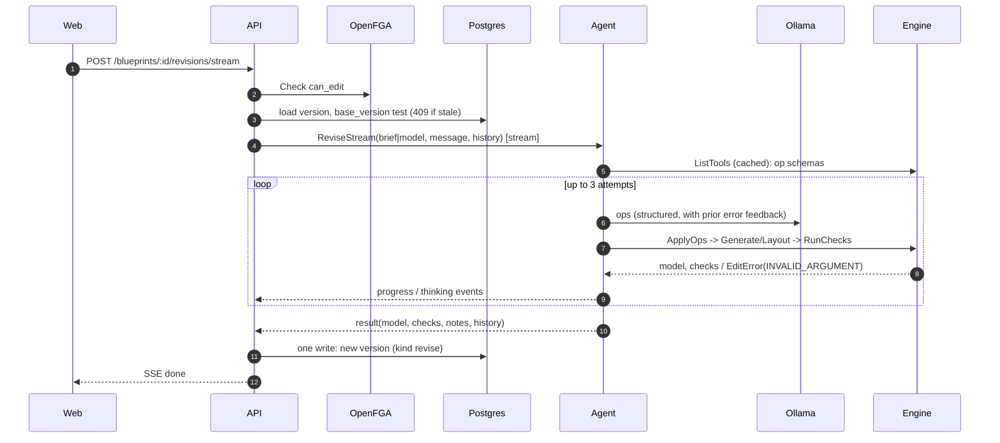
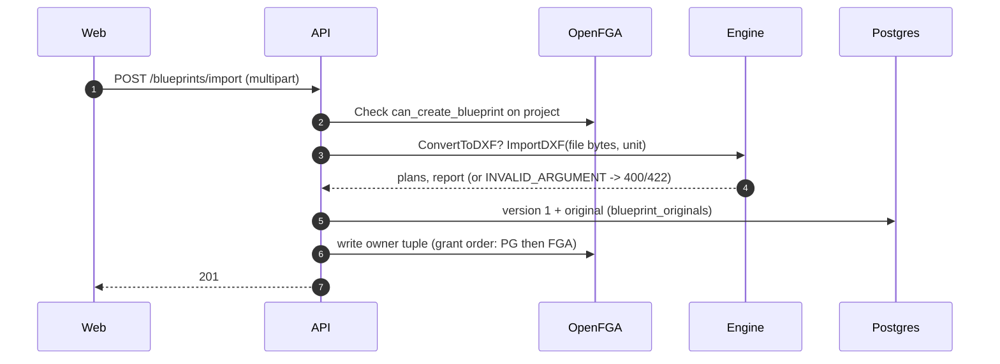
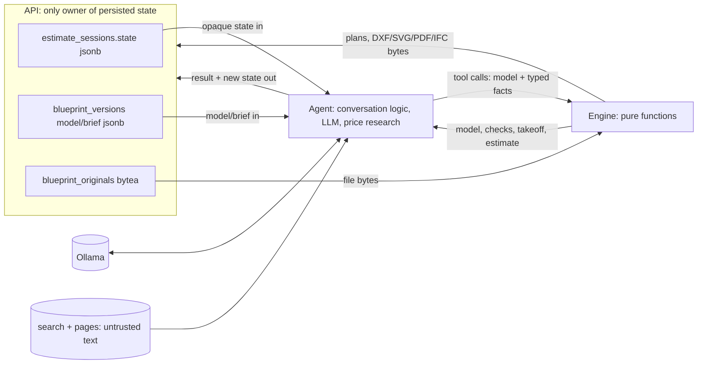

# System design: re-architecture-system

Input: [requirements.md](requirements.md) (approved 2026-11-19). Behavior of the HTTP API and web panel does not change; this is a re-partitioning of the sidecar into **Agent** and **Engine** plus the API clients that call them.

## Findings that shape the design
- Only five engine flows really use the LLM: `brief_from_text`, `revise` (brief chat), `revise_plan` (plan chat), `review`, and the estimate turn (`estimate_agent.run_turn`, with `price_research`). `llm_steps.create` and `create_plan` take an `llm` argument but never call it (they fit and draw deterministically), so they are Engine operations.
- The LLM flows loop over deterministic steps (apply ops -> layout -> checks -> feed errors back to the LLM). Those steps become **Engine tools** the Agent calls; the loop itself is Agent logic.
- The Agent needs to read a plan (rooms, fixtures, openings) and the Engine needs the estimate facts (`takeoff`/`price` read only `state.facts` (value **and source**, e.g. `assumed`), `excluded`, `fixtures_existing`, `scope`). To avoid a shared Python library, each side owns its own types: the Engine returns a `PlanSummary` and accepts typed `EstimateFacts`; the Agent owns the conversation state (slots, questions, history) and the API stores it as an opaque blob exactly as today. The Agent maps its types to proto messages in `infrastructure/engine_grpc` (an anti-corruption layer).
- The LLM loops call deterministic Engine code inside each attempt (`apply_ops`, `apply_plan_ops`, `draft_to_brief`, `generate`, issue scoring) and the prompts need Engine constants (`MIN_AREA`, `NESTABLE_TYPES`, `MAX_NESTED`, `DEFAULT_FIXTURES`, rate catalog) and op field signatures. Rule: **the Engine owns every schema and constant of what it consumes; the Agent gets them over RPC (`ListTools`, `GetCatalog`) and never duplicates them.** Each loop attempt is one coarse Engine RPC, not a chain of fine ones.
- `plan_edits.py` imports `prompts._field_sig` today and `prompts.py` imports `schemas`: a two-way dependency. It is cut by moving the op documentation helper (`_field_sig` and op docs) into the Engine and publishing it in `ListTools`; `prompts.py` in the Agent keeps only the knowledge pack text and reads constants from `GetCatalog`.

## Components changed
| Component | Change | Why |
| --- | --- | --- |
| `proto/` (new) | create: `agent/v1`, `engine/v1`, `common/v1`; `buf.yaml`, `buf.gen.yaml` | one versioned contract source; lint + breaking checks in `make check` |
| `agent/` (new, Python, gRPC :8091) | create: layered package `agent` (layout below); owns `llm.py`, `llm_steps.py`, `prompts.py`, `estimate_agent.py`, `estimate_reading.py`, `price_research.py`, `price_source.py`, `demo_search.py`, `progress.py`, the golden evals (`eval/`) | all LLM, web egress and decision logic in one place |
| `blueprint-engine/` (Python, gRPC :8092) | update: re-layer by layer; drop LLM/web code, FastAPI and NDJSON; remove `httpx`; keep geometry, DXF/PDF/picture/IFC, checks, takeoff, pricing math; add `ListTools` and `SummarizePlan`; `takeoff`/`price` take `EstimateFacts` instead of the agent's session state | no LLM, no DB, no network; one protocol |
| `api/` infrastructure | create `infrastructure/agent` (gRPC client), replace `infrastructure/blueprintengine` HTTP client with `infrastructure/engine` (gRPC client), add `infrastructure/grpcutil` (deadlines, request-id metadata, status -> error mapping); config: `BLUEPRINT_ENGINE_URL` (http URL) is replaced by `BLUEPRINT_ENGINE_ADDR` (default `localhost:8092`) and a new `AGENT_ADDR` (default `localhost:8091`), both gRPC `host:port` targets (`config.go`, `.env`, `docs/operations.md`) | clients implement gateways |
| `api/` domain/usecase/service | update: split `gateway.BlueprintEngine` into `BlueprintAgent` (BriefFromText, Revise, ReviseStream, RevisePlan, RevisePlanStream, Review; the sync and stream variants stay in the interface, the client implements both over the one streaming RPC) and `BlueprintEngine` (Generate, CreatePlan, DrawPlan, EditPlan, PatchDXF, ConvertToDXF, ImportDXF, Render); `EstimateEngine` becomes `EstimateAgent`. Verified by grep: every service makes exactly one sidecar call, so none needs both gateways. Agent: `blueprint_drafter`, `blueprint_reviser`, `blueprint_revise_streamer`, `blueprint_reviewer`, `estimate_session_messenger`. Engine: `blueprint_creator`, `blueprint_brief_updater`, `blueprint_importer`, `blueprint_dxf_previewer`, `blueprint_drawing_renderer`, `blueprint_original_exporter`, `blueprint_plan_converter`, `blueprint_plan_editor`. Check order and "sidecar before any write" ordering unchanged. Tests: `infrastructure/blueprintengine/client_test.go` is replaced by tests for the two gRPC clients; service tests (`blueprint_reviser_test`, `blueprint_helper_test`, `estimate_session_test`, ...) swap their fake to the matching gateway | services stay business logic; DI via interfaces |
| `api/cmd/api/wire.go` | update: build both clients | only graph builder |
| `web/` | none | HTTP/SSE contract unchanged |
| OpenFGA model / tuples | none | no new action |
| Postgres | none (db-design skipped) | state/model stay opaque `jsonb`/`bytea` written by the API |
| `scripts/`, `Makefile`, `deploy/` | update: `check-architecture.sh` gains Python rules; Make targets `agent`, `agent-test`, `agent-eval`, `agent-eval-estimate` (the two `engine-eval*` targets move), `engine` (gRPC server instead of uvicorn), `engine-test`, `proto` (buf lint, breaking, generate; fails if generated stubs differ from committed ones); `check` and `verify-live` run both pytest suites and `proto`; `.PHONY` updated; `scripts/init.sh` runs `uv sync --frozen` for both projects, checks `buf`/`protoc` tools and prints "ollama serve && make engine && make agent". `deploy/docker-compose.yml` has no engine today and is unchanged | enforce the layering |
| infra / 3rd party | Ollama (Agent only), search provider Brave/Serper (Agent only); two host processes | Metal GPU needs host |

### Service topology

Allowed edges are exactly these. Engine has no outbound edges; Agent has no edge to API, Postgres or OpenFGA.

## Sequence diagrams

### 1. Estimate chat turn (LLM flow, streaming)


### 2. Plan or brief chat revision (LLM loop over Engine tools)


### 3. Deterministic operation (no LLM): import, convert, render, direct edit, export

The Agent is not involved; if the Agent is down this flow works (criterion 6).

## Data flow

Neither sidecar stores anything. Page text is untrusted data inside the Agent only; the quote-check code stays with the Agent next to the LLM that reads it.

## Contracts (`proto/`)
Packages `fga.demo.agent.v1`, `fga.demo.engine.v1`, `fga.demo.common.v1` (Status/progress types). Plan model, brief and session state cross as `bytes` holding the same JSON used today (their schema is each owner's pydantic model; the API treats them as opaque, as now). Typed messages are used for things a service must interpret: `EstimateFacts`, `RateRequest/RateResult`, `Takeoff`, `Check`, `PlanSummary`, `Upload`, `ConvertOptions`, `TitleBlock`.

```text
agent.v1.AgentService
  BriefFromText(TextRequest)            returns (BriefDraft)                 unary (no progress today)
  Revise(ReviseRequest)                 returns (stream Event)               event = progress | thinking | result
  RevisePlan(RevisePlanRequest)         returns (stream Event)
  Review(ReviewRequest)                 returns (stream Event)
  EstimateTurn(EstimateTurnRequest)     returns (stream EstimateEvent)       progress|token|fact|question|rate|estimate|done
engine.v1.EngineService  (all unary, no LLM, no network)
  Catalog:   ListTools (name, description, JSON Schema, field-signature text for DraftBrief, BriefOps, PlanOps),
             GetCatalog (MIN_AREA, MIN_WIDTH, nestable types, max nested, default fixtures, fixture kinds, default markups, rate catalog, priced fixtures)
  Brief:     NormalizeDraft (DraftBrief JSON -> Brief + notes), Generate (brief, previous, repair -> model, checks, issues,
             issue_score, error_rules, checks_line), ApplyBriefOps (brief, ops, previous -> same result as Generate),
             CreatePlan, DrawPlan
  Plan:      SummarizePlan (model, facts -> PlanSummary), ApplyPlanOps (model, ops -> PlanStep; also the direct-edit
             path, so chat and the buttons share one tool), RunChecks
  Estimate:  Takeoff (model, EstimateFacts -> lines), PriceEstimate (takeoff, rates, EstimateFacts -> estimate)
  Files:     ConvertToDXF, ImportDXF, PatchDXF, Render
grpc.health.v1.Health on both servers
```
**Loop calls (what the Agent's `service` may call per attempt).** Brief draft: `NormalizeDraft` then `Generate`. Brief revise: `ApplyBriefOps` (returns the score and error rules the retry/review logic needs, so no engine code is imported). Plan revise: `ApplyPlanOps`. Review: `Generate`/`ApplyBriefOps` per round using the returned `issue_score`. Estimate: `SummarizePlan`, `Takeoff`, `PriceEstimate`. The Agent never calls `Render` or file ops.

`PlanSummary` fields: rooms `{id, name, type, area_m2, storey?}`, fixtures `{id, kind, room_id, installed?}`, openings `{id, kind (door|window|open), room_ids, width}`, plus `pending_fixtures` and `structure_in_scope` (computed by the Engine from the facts, replacing the Agent's use of `takeoff.pending_fixtures` and `structure_in_scope`). The estimate turn calls `SummarizePlan` once and `Takeoff`/`PriceEstimate` once each, so the model crosses the wire at most three times per turn.

**Review and plan-chat needs (all answered by the Engine, nothing imported).** `Generate`/`ApplyBriefOps` results also carry `brief` (normalized, for the prompt), `total_target_area`, per-room `target_area` and a `changed` flag (no-op detection, the 15% area cap); the Agent applies `REVIEW_AREA_CAP` itself (an Agent policy) and filters forbidden review ops by op name against `ListTools`, which publishes one entry per op (name, JSON Schema, signature text) so op help with exclusions is built in the Agent from those entries. `ApplyPlanOps` returns `PlanStep` with `summary` (what `plan_edits.summary` gives) and `descriptions` (one `describe(op)` line per applied op), so neither helper is called from the Agent. `history_block` is a pure Agent prompt helper and stays there. Errors carry a code in the gRPC status detail: `edit_error` (retry with feedback) vs `unsupported` (stop the loop); both are `INVALID_ARGUMENT`.

**Estimate enums and types.** `common.v1` holds the shared vocabulary as proto enums/messages: `Quality`, `WorkType`, `RoomState`, `RoomScope`, `RateSource`, `Fact`, `RateRequest`, `RateResult`. Each service generates its own copy from them (no shared Python code); the Agent's pydantic types for `price_research` and slots are mapped from the generated classes in `infrastructure/engine_grpc`. Agent slot and extraction code is rewritten against `PlanSummary` (rooms, fixtures, `PRICED_FIXTURES` from `GetCatalog`) instead of `BuildingModel`. `GetCatalog` also carries `MIN_WIDTH`, `FIXTURE_KINDS`, `DEFAULT_MARKUPS` and `REVIEW`-independent constants; `prompts.CONVENTIONS` f-strings are built at Agent start-up from the catalog, not at import time (the Agent loads the catalog lazily on first use with retry and caches it; its gRPC health reports `NOT_SERVING` until loaded).

**Estimate types split.** `estimate_models.py` is divided: Engine domain keeps `EstimateFacts` (name, value, source), `Takeoff`, `TakeoffLine`, `Estimate`, `RateRequest`, `RateResult`; Agent domain keeps `SessionState` (slots, asked questions, excluded, fixtures_existing mirror, scope), `Message`, `Question`, `Extracted`. `RateSpec`/`RATE_CATALOG` live in the Engine; the Agent reads them once from `GetCatalog` (used by `requests_for`, fixture questions, extraction hints).

**Streaming rules.** The three revise/review RPCs replace the sync and NDJSON pairs: the API client collects the stream when the caller is sync. An error before the first event is a gRPC status in the call's trailers (maps to a plain 4xx/5xx exactly like today's pre-stream refusals); an error after the first event is an in-band `error` event carrying `{status, error, message}` (the SSE is already open), mirroring `ndjson()` in `app.py`. A wire-parity test covers both, plus an Engine failure inside an Agent tool call (in-band `502 engine_unavailable`). **Cancel**: the Agent servicer registers `context.add_callback` and sets a cancel token checked at each progress emit and between tool calls (as `progress.Cancelled` does now) and cancels its in-flight outgoing Engine RPC; a single long Engine call is not interruptible (same as today) but its result is dropped.

The non-streaming HTTP calls collapse into these RPCs, so there is one code path per flow. Max message size 32 MB (uploads are capped at 20 MB). Every unary call has a deadline set by the API client (5 min default; `EstimateTurn` up to the 30 min ceiling). Metadata `x-request-id` is propagated API -> Agent -> Engine and logged by all three; no tenant/user ids ever.

### Error mapping (one table in `infrastructure/grpcutil`)
| gRPC status | API error | HTTP |
| --- | --- | --- |
| `INVALID_ARGUMENT` (EditError, UnsupportedEdit via detail code, bad file) | `ErrValidation` | 400/422 as today |
| `UNAVAILABLE`, connection refused, `llm_unavailable` detail | `ErrEngineUnavailable` | 502 `engine_unavailable` |
| `DEADLINE_EXCEEDED` | `ErrEngineUnavailable` | 502 |
| `CANCELLED` (client left) | none, nothing written | none |
| other | internal | 500 |
Before the first stream event the status is a gRPC status as above; after it, the Agent reports Engine `UNAVAILABLE` (detail `engine`) and Ollama failures (`llm_unavailable`) as in-band error events with status 502.

## Code layout (both Python services mirror `api/internal`)
```text
agent/                                   blueprint-engine/
  pyproject.toml, uv.lock                  pyproject.toml, uv.lock
  src/fga_agent/                               src/fga_engine/
    domain/entity/   pure pydantic/        domain/entity/   BuildingModel, Brief, Check, Takeoff...
    domain/gateway/  Protocols:            domain/gateway/  Protocols for infra the use cases need
      LLM, PlanTools (engine), PriceSearch,   (DXF reader/writer, PDF/picture reader, IFC writer)
      PageFetcher, Clock
    usecase/         one Protocol/op:      usecase/         one Protocol/op: ImportDXF, ConvertToDXF,
      EstimateTurner, BriefReviser,           Generate, ApplyPlanOps, RunChecks, Takeoff, Render...
      PlanReviser, BriefReviewer,
      BriefDrafter  (+ usecase/helper)
    service/         one file/op: logic,   service/         one file/op; layout, checks, geometry rules
      slots, retry-with-feedback loop,        are domain functions called from here
      price quote checks
    infrastructure/  ollama, search_brave,  infrastructure/  ezdxf, ifcopenshell, opencv, pdfium, rapidocr
      search_serper, search_demo,
      page_fetch (robots), engine_grpc, config
    handler/grpc/    AgentService servicer  handler/grpc/    EngineService servicer
    wire.py          the only graph builder wire.py
    (stubs are not here: imported from the shared `fga` package, proto/python)
  tests/  eval/
```
Rules enforced by `check-architecture.sh` (grep on imports, mirroring rule 1): `domain`, `usecase`, `service` never import `grpc`, `httpx`, `ollama`, `ezdxf`, `ifcopenshell`, `cv2`, `pypdfium2`, `rapidocr`, `google.protobuf`, the generated stubs (package `fga`, `proto/python`); `engine` imports no `httpx`/`ollama`/`urllib.request`/`socket` anywhere; `agent` imports no engine package (only the generated client); only `wire.py` instantiates infrastructure; `handler` calls exactly one usecase method per RPC and maps errors in one place.

Move map (no behavior change; each module goes whole to its layer, split only along existing seams):
| Today (`blueprint_engine/`) | Goes to |
| --- | --- |
| `schemas.py`, `building.py`, `layout.py`, `checks.py`, `fixtures.py`, `edits.py`, `plan_edits.py` (+ `_field_sig` op docs from `prompts.py`) | engine `domain` (entities, pure rules, op schemas) |
| `pipeline.py`, `estimate.py`, `takeoff.py`; from `llm_steps.py`: `create`, `create_plan`, `draw_plan`, `edit_plan`, `generate_fitted`, `draft_to_brief` (`NormalizeDraft`), scoring helpers (`_score`, `_error_rules`, `_checks_line`) | engine `service` (one file per op) |
| `dxf_plan.py`, `dxf_drawing.py`, `dxf_patch.py`, `convert.py`, `draw.py`, `ifc.py` | engine `infrastructure` readers/writers behind gateways (pure geometry helpers go to `domain`) |
| `estimate_models.py` | split: facts/takeoff/estimate/rate types -> engine `domain`; `SessionState`, `Message`, `Question` -> agent `domain/entity` |
| from `llm_steps.py`: `_with_feedback`, `brief_from_text`, `enhance`, `revise`, `revise_plan`, `review`; `prompts.py` (knowledge text only); `estimate_agent.py`, `estimate_reading.py` | agent `service` / `domain` (loops, slots, extraction), one file per usecase |
| `llm.py` | agent `infrastructure/ollama` behind `domain/gateway.LLM` |
| `price_research.py` (quote checks in `service`, search/fetch in `infrastructure`), `price_source.py`, `demo_search.py` | agent |
| `progress.py` | agent: a `Progress` model and a progress callback passed into the use case, bridged to the gRPC stream by `handler/grpc/common/streaming_helper.py` (which also holds the cancel token); `Cancelled` is a domain error. The Engine does not use it (verified by grep) |
| `app.py`, `static/` (demo harness page at `GET /`), `GET /healthz` | removed: replaced by gRPC handlers and the gRPC health service. The harness is a dev page, not a product feature, so "no behavior change" holds; `blueprint-engine/README.md`, `docs/operations.md` and `docs/testing.md` references to it are removed |
| `eval/run.py`, `eval/estimate_run.py`, `golden.json`, `estimate_golden.json` | `agent/eval/` (runners call the Agent's usecases with the real Ollama and a real or in-process Engine) |
| `tests/` (7 files, 210 collected tests (157 functions), none deleted) | `test_pipeline`, `test_import`, `test_convert`, `test_drawing`, `test_patch` and `sample_dxf.py`/`briefs.py`/`samples/` -> `blueprint-engine/tests` (call usecases; plus a thin gRPC servicer test over an in-process server); `test_estimate` splits: takeoff/pricing cases -> engine, interview/extraction/price-research cases -> `agent/tests` with a scripted FakeLLM and a fake `PlanTools`; `test_app` (builds `create_app(FakeLLM)`) splits into engine gRPC handler tests and agent servicer tests. The plan lists each test function's destination and a count check (210 collected node IDs before, all accounted for after, plus new ones) |

## Authorization
No new action, relation, tuple or model change (`docs/decision-catalog.md` unchanged). Every Check stays in the API service before any Agent/Engine call (CLAUDE.md invariants unchanged). Invariants touched:
- "Only the API calls the engine" becomes: the API calls Agent and Engine; the Agent calls the Engine as tools; nothing else. Update CLAUDE.md and `ARCHITECTURE.md`.
- "The engine never sees tenant or user ids" extends to the Agent: no tenant/user/project id in any proto message or metadata (only an opaque `x-request-id`). A test inspects the proto field names against a deny list (`tenant`, `user`, `project`, `actor`).
- Search queries carry only item description, unit, region, quality grade (unchanged), now enforced in the Agent.
- Neither service is reachable from the browser (bound to localhost; the Vite proxy only targets the API).

## API contract
No HTTP change: `docs/http-api.md` routes, bodies and statuses are identical. Only the internal gRPC contract above is new (`docs/operations.md` lists ports/env; a new `docs/service-contracts.md` summarizes the protos and error mapping).

## Docs to update in the same change
- `ARCHITECTURE.md` (system context, service table, principles), new `agent/ARCHITECTURE.md`, new `blueprint-engine/ARCHITECTURE.md` (layers), `blueprint-engine/README.md`, new `agent/README.md`.
- `api/ARCHITECTURE.md` (infrastructure clients, two gateways), `docs/operations.md` (ports 8091/8092, env `AGENT_ADDR`/`BLUEPRINT_ENGINE_ADDR`, Ollama/search vars move to the Agent, compose/Make targets), `docs/testing.md` (agent/engine test tiers, the 210-test remap, evals move, harness page gone), `scripts/init.sh`, `Makefile`, new `docs/service-contracts.md`.
- `CLAUDE.md` (intro sentence, commands, architecture rules for Python services, the two invariants above), `README.md` run steps, `docs/harness/progress.md`, `docs/harness/decisions.md` (record the split), `docs/harness/quality.md` if it tracks services.

## Risks and alternatives rejected
- **Behavior drift of the LLM flows when moved.** Mitigation: move code verbatim first, switch the API per flow, run golden evals (`agent/eval`) before and after; keep the old HTTP endpoints until each flow is verified, then delete.
- **gRPC overhead of round-tripping the plan model on each tool call.** Models are small JSON (tens of KB); a revise makes a handful of calls; acceptable. If it ever matters, pass a model handle, but that would need Engine state, which we reject.
- **Duplicated types** (plan model seen by Agent and Engine): mitigated by `SummarizePlan` and `ListTools` schemas; the model JSON stays opaque `bytes` to the Agent except through those.
- **Streaming cancel across two hops**: tested explicitly (criterion 4); Agent runs work on a thread with a cancel token as `progress.py` does today.
- Rejected: Agent in Go (decided); everything through the Agent as a proxy (decided); HTTP/NDJSON for the sidecars (decided); a shared Python library for types (extra coupling; decided against in requirements); stateful Agent with its own DB (second datastore, breaks "API owns data"); a free LLM tool-calling loop now (qwen3 8B reliability), the registry abstraction keeps it open.

## Changes after approval
- 2026-11-19 (plan review): Python packages are named `fga_agent` and `fga_engine` (no generic top-level names); Engine gRPC port is :8092 for good (Agent :8091), so the topology labels read 8092; baseline is 210 collected pytest node IDs.
