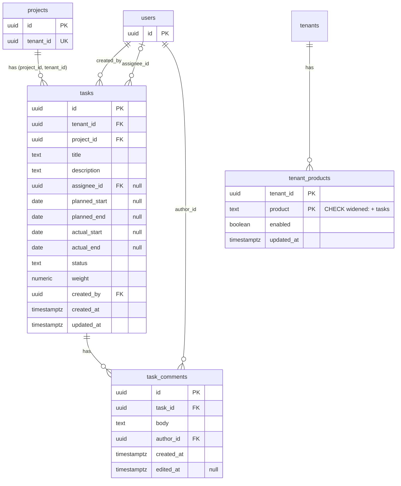

# DB design: task-management

Next migration: `00012_tasks.sql`. Must not break the running system: the previous build keeps working against the new schema (two new tables and one widened CHECK, a strict superset, the one flagged exception in section 11).

## 1. Summary
Stores per-project tasks (work items) and their comments as Postgres display records. Authorization stays in OpenFGA (`system-design.md`); the only tuples are the two per comment. Progress is computed by SQL aggregate, nothing is stored for it. Adds the `tasks` product value.

## 1b. Current schema touched
| Existing | How |
| --- | --- |
| `projects (id, tenant_id)` with `UNIQUE (id, tenant_id)` (00005) | composite FK target for `tasks`, same as `blueprints_project_fk` (00006) |
| `users (id)` (00001) | FK for `created_by`, `assignee_id`, `author_id`; `LEFT JOIN` for display names |
| `tenant_products` + `tenant_products_product_check` (00001, widened in 00006) | CHECK widened to add `'tasks'`; one `false` row per tenant (precedent: 00006 does the same for `blueprints`) |
| `tenant_members` (PK `(tenant_id, user_id)`, carried from `memberships`, 00001/00005) | read by the assignee-candidate query only; not referenced by an FK (membership is an OpenFGA decision) |
| `postgres/db.go` `Truncate` | lists the new tables (FK order) |

Precedents followed: `blueprints` (project-scoped parent with composite FK, `tenant_id`-leading index), `estimate_messages` / `blueprint_versions` (ordered child keyed to its parent, no `tenant_id`, reached only through the parent loaded under `WHERE tenant_id`).

## 2. Access paths
| # | Query (what, by whom) | Filter / sort | Rows | Frequency | R/W |
| --- | --- | --- | --- | --- | --- |
| Q1 | List tasks of a project (Tasks tab), with assignee name | `t.tenant_id=$1 AND t.project_id=$2 ORDER BY created_at, id`; `LEFT JOIN users` on PK | <= ~hundreds | every tab open | R |
| Q2 | Comment counts for those tasks | `task_id = ANY($ids) GROUP BY task_id` (one query, no N+1) | same | with Q1 | R |
| Q3 | Project progress and counts | `tenant_id=$1 AND project_id=$2 GROUP BY status` (`SUM(weight)`, `COUNT`) | same | with Q1, after each change | R |
| Q4 | Get a task / load it before PATCH, DELETE, comment (tenant check from the row) | `id=$1 AND tenant_id=$2` | 1 | every task call | R |
| Q5 | Lock the task row for comment create and task delete | `id=$1 AND tenant_id=$2 FOR UPDATE` | 1 | writes | R/W |
| Q6 | Insert, update, delete a task | PK | 1 | writes | W |
| Q7 | List comments of a task with author name | `task_id=$1 ORDER BY created_at, id`, `LEFT JOIN users` | <= 50 | drawer open | R |
| Q8 | Count comments of a task (cap 50) | `task_id=$1` | <= 50 | per comment add, under Q5's lock | R |
| Q9 | Load a comment with its task's tenant and project | `c.id=$1 JOIN tasks t ON t.id=c.task_id WHERE t.tenant_id=$2` | 1 | per edit/delete | R |
| Q10 | Comment ids of a task (to delete their tuples) | `task_id=$1` | <= 50 | task delete | R |
| Q11 | Insert, update, delete a comment | PK | 1 | writes | W |
| Q12 | Assignee candidates: the tenant's member rows | `tenant_members WHERE tenant_id=$1` (existing PK/index), then BatchCheck `can_access` | tenant roster | assign dialog | R |

## 3. ER diagram


## 4. Table schemas

### `tasks`
```sql
CREATE TABLE tasks (
    id            uuid PRIMARY KEY,
    tenant_id     uuid NOT NULL REFERENCES tenants (id) ON DELETE CASCADE,
    project_id    uuid NOT NULL,
    title         text NOT NULL CHECK (char_length(title) BETWEEN 1 AND 200),
    description   text NOT NULL DEFAULT '' CHECK (char_length(description) <= 10000),
    assignee_id   uuid REFERENCES users (id) ON DELETE SET NULL,
    planned_start date,
    planned_end   date,
    actual_start  date,
    actual_end    date,
    status        text NOT NULL DEFAULT 'not_started'
        CHECK (status IN ('not_started', 'in_progress', 'completed', 'blocked')),
    weight        numeric(8,2) NOT NULL DEFAULT 1 CHECK (weight > 0),
    created_by    uuid NOT NULL REFERENCES users (id),
    created_at    timestamptz NOT NULL DEFAULT now(),
    updated_at    timestamptz NOT NULL DEFAULT now(),
    CONSTRAINT tasks_project_fk FOREIGN KEY (project_id, tenant_id)
        REFERENCES projects (id, tenant_id) ON DELETE CASCADE,
    CONSTRAINT tasks_planned_range_check CHECK (planned_end >= planned_start),
    CONSTRAINT tasks_actual_range_check CHECK (actual_end >= actual_start)
);
CREATE INDEX tasks_tenant_project_idx ON tasks (tenant_id, project_id, created_at, id);
```
A CHECK with a NULL operand passes, so the range rules apply only when both dates are set.

| column | type | null | default | meaning / source |
| --- | --- | --- | --- | --- |
| id | uuid | no | | API-generated; not an OpenFGA object (tasks have no tuples) |
| tenant_id | uuid | no | | from the project row; scoping and index lead |
| project_id | uuid | no | | owning project, composite FK keeps it in the same tenant |
| title | text | no | | 1..200 chars |
| description | text | no | `''` | empty means none; the API omits it |
| assignee_id | uuid | yes | | one project member, verified by the OpenFGA `can_access` Check at write time |
| planned_*/actual_* | date | yes | | calendar dates, no time zone |
| status | text | no | `not_started` | closed set |
| weight | numeric(8,2) | no | 1 | > 0, 2 decimals; not float |
| created_by | uuid | no | | actor |
| created_at / updated_at | timestamptz | no | now() | updated_at set by the service on each PATCH |

**Backward compatible because:** a new table nothing old reads or writes.

### `task_comments`
```sql
CREATE TABLE task_comments (
    id         uuid PRIMARY KEY,
    task_id    uuid NOT NULL REFERENCES tasks (id) ON DELETE CASCADE,
    body       text NOT NULL CHECK (char_length(body) BETWEEN 1 AND 4000),
    author_id  uuid NOT NULL REFERENCES users (id),
    created_at timestamptz NOT NULL DEFAULT now(),
    edited_at  timestamptz
);
CREATE INDEX task_comments_task_created_idx ON task_comments (task_id, created_at, id);
```
| column | type | null | default | meaning / source |
| --- | --- | --- | --- | --- |
| id | uuid | no | | API-generated; equals the OpenFGA `task_comment` object id |
| task_id | uuid | no | | parent; comments are deleted with the task |
| body | text | no | | 1..4000 chars |
| author_id | uuid | no | | actor; mirrors the `owner` tuple (display only, the decision is in OpenFGA) |
| created_at | timestamptz | no | now() | |
| edited_at | timestamptz | yes | | set on PATCH; no `updated_at` (it would duplicate it) |

**Backward compatible because:** a new table nothing old reads or writes.

### `tenant_products` (altered)
```sql
-- force-allow-breaking: widening a closed set only; old code never writes 'tasks', and reads of the extra row are harmless
ALTER TABLE tenant_products DROP CONSTRAINT tenant_products_product_check;
ALTER TABLE tenant_products ADD CONSTRAINT tenant_products_product_check
    CHECK (product IN ('documents', 'photos', 'blueprints', 'tasks')) NOT VALID;
ALTER TABLE tenant_products VALIDATE CONSTRAINT tenant_products_product_check;
INSERT INTO tenant_products (tenant_id, product, enabled)
SELECT id, 'tasks', false FROM tenants ON CONFLICT DO NOTHING;
```
**Backward compatible because:** every old value stays valid. The previous build keeps creating tenants with three product rows only, so a tenant created while it runs has no `tasks` row. The migration's backfill cannot cover those, so the new build must: `ProductRepo.Set` changes from `SELECT ... FOR UPDATE` + `UPDATE` (which returns not-found on a missing row, `product_repo.go:40-50`) to `INSERT INTO tenant_products (tenant_id, product, enabled) VALUES (...) ON CONFLICT (tenant_id, product) DO UPDATE SET enabled = EXCLUDED.enabled, updated_at = now()` returning the previous value (read under the same transaction first), and the product list shows a missing row as disabled. New tenants created by the new build insert four rows. The old build lists the extra `tasks` row as an unknown product at worst (display only).

## 5. Design decisions
- **Keys**: `uuid` from `idgen`. Task ids are not FGA objects but share the convention. Comment ids equal the FGA object id.
- **Tenant scoping**: `tasks` has `tenant_id` plus the composite project FK (a task can never point at another tenant's project, as `blueprints`). `task_comments` has no `tenant_id`: every path loads the task (or the comment joined to its task) under `tenant_id = $header` first (Q4, Q9; precedent `estimate_messages`, `blueprint_versions`).
- **FK actions**: project and tenant delete CASCADE (owned children); `created_by`/`author_id` default NO ACTION like `blueprints.created_by`; `assignee_id` SET NULL (the task must survive). No FK to `tenant_members` for the assignee: a removed member simply stays shown until reassigned, and the write-time authority is the OpenFGA Check; a `(tenant_id, assignee_id)` FK would need SET NULL on a column list and still not express project access.
- **Normalization**: no stored progress, comment count or assignee name (all derived by Q1-Q3). No status column duplicating dates; status and dates are independent by requirement.
- **`description text NOT NULL DEFAULT ''`** instead of nullable: one empty representation. Other optional fields are nullable because "unset" differs from any value.
- **Constraint names**: inline CHECKs on `title`, `description`, `status`, `weight` keep Postgres's generated names (`tasks_title_check`, ...), which already follow `<table>_<col>_check`; the two range CHECKs and the FK are named.
- **Not added**: no `deleted_at` (hard delete), no ordering column (non-goal), no history/audit table (non-goal), no `tenant_id` on comments, no array of assignees, no jsonb.
- **Concurrency**: the 50-comment cap and the task delete serialize on `SELECT ... FOR UPDATE` of the task row (Q5), not on a counter column.

## 6. Indexes
| index | table (columns) | serves | type | unique | cost |
| --- | --- | --- | --- | --- | --- |
| `tasks_pkey` | tasks (id) | Q4, Q5, Q6, Q9 join | btree | yes | none beyond PK |
| `tasks_tenant_project_idx` | tasks (tenant_id, project_id, created_at, id) | Q1 (filter and sort), Q3 | btree | no | one index; also serves the composite FK's cascade delete from `projects` |
| `task_comments_pkey` | task_comments (id) | Q9, Q11 | btree | yes | |
| `task_comments_task_created_idx` | task_comments (task_id, created_at, id) | Q2, Q7, Q8, Q10, the cascade from `tasks` | btree | no | one index, leading with the FK |

Q12 uses the existing `tenant_members` key. `assignee_id` has no index: it is never a filter in SQL (the "assigned to me" filter is client-side), and `users` rows are never deleted. `tenant_id` on `tasks` for the tenant-cascade is covered by the leading column.

```sql
-- migration section: new tables, so plain CREATE INDEX (check-migrations exempts same-migration tables)
```

## 7. Query plans
Expected, to be replaced by real `EXPLAIN (ANALYZE, BUFFERS)` on seeded data at build time.
- Q1: `Index Scan using tasks_tenant_project_idx` (no Sort node, the index order is the order) + `Index Scan using users_pkey` per row via nested loop.
- Q2: `Index Only/Scan using task_comments_task_created_idx` with `task_id = ANY(...)`, `GroupAggregate`/`HashAggregate`.
- Q3: `Index Scan using tasks_tenant_project_idx`, `HashAggregate` on status.
- Q4/Q5/Q9: `Index Scan using tasks_pkey` / `task_comments_pkey`.
- Q7/Q8/Q10: `Index Scan using task_comments_task_created_idx` (Q8 an Index Only Scan / aggregate).
A `Seq Scan` on a table this small right after seeding is acceptable only if the planner chooses it with fewer than a page of rows; record the node and note it.

## 8. Migration plan
`api/migrations/00012_tasks.sql`, one concern (the tasks feature's tables plus its product value):
- **Up**: `CREATE TABLE tasks`, its index, `CREATE TABLE task_comments`, its index, then the `tenant_products` widening and backfill above (the flagged statement is only the DROP CONSTRAINT). The migration starts the `tenant_products` part with `SET LOCAL lock_timeout = '5s';` (inside goose's transaction), so a blocked swap fails fast instead of queueing behind traffic.
- **Down**:
```sql
DROP TABLE IF EXISTS task_comments;
DROP TABLE IF EXISTS tasks;
DELETE FROM tenant_products WHERE product = 'tasks';
ALTER TABLE tenant_products DROP CONSTRAINT tenant_products_product_check;
ALTER TABLE tenant_products ADD CONSTRAINT tenant_products_product_check
    CHECK (product IN ('documents', 'photos', 'blueprints'));
```
The Down's plain `ADD CONSTRAINT` and `DELETE` are acceptable because `scripts/check-migrations.py` reads only the Up section (as 00006's Down does). Down loses every task and comment (demo data, stated). OpenFGA tuples (`tasks_enabled`, `task_comment`) are not touched by SQL; after a rollback the seed or the stale tuples are harmless because no route reads them.
- **Expand -> backfill -> contract**: expand only (new tables, widened CHECK). The backfill is one small `INSERT` (one row per tenant), part of the migration, same as 00006. No contract step.
- **Locks**: `ALTER TABLE tenant_products` takes `ACCESS EXCLUSIVE` for the constraint swap on a table of (tenants x 4) rows, milliseconds; run with `SET lock_timeout = '5s'`. `VALIDATE` scans that tiny table with a weaker lock. New tables take no lock on running code.
- **Rollback of the app**: the previous build ignores the new tables and still passes the widened CHECK. Old tenant creation inserts three product rows only, which the CHECK allows.
- **Rollout order**: migration (applied by the API on start), then new build; the OpenFGA model with `tasks_enabled`, `can_*_tasks` and `task_comment` is written by the seed or, on a live store, by writing a new model version before the new API starts (API opens the newest model; covered by the plan).

## 9. Checks
- [ ] No drop/rename of used columns or tables (true); the skill forbids a CHECK change on an existing table, and this design does one as the flagged exception in section 11 (strict superset, `NOT VALID` then `VALIDATE`, precedent 00006); no NOT NULL without DEFAULT on an existing table (new tables only)
- [x] Tenant scoping per table: `tasks` column + composite FK; `task_comments` parent-first (Q4, Q9) with precedent
- [x] FK `ON DELETE` chosen (CASCADE owned children, SET NULL assignee, default for `created_by`/`author_id`); CHECKs for status, weight, ranges, lengths; no natural key needing UNIQUE
- [x] Every access path maps to a PK or named index (section 6); no redundant index; cascading FKs led by an index
- [x] No N+1 (Q2 is one `= ANY`), no `SELECT *`, no jsonb
- [x] Down works; data loss stated
- [ ] `Truncate`, seed, `docs/database-schema.md`, `docs/seed-data.md` updated (at build, task in plan)
- [ ] At build: dry run Up and Down with `BEGIN; \i api/migrations/00012_tasks.sql; ROLLBACK;` (Up part and Down part) on the live schema and on a seeded copy; EXPLAIN on seeded data; start the previous build on the migrated DB and smoke-test it. Restore point: the demo database is rebuilt by `make seed`; anywhere else take `pg_dump -Fc` first.

## 10. Docs and seed changes
- `docs/database-schema.md`: ER diagram, two new tables, the `tenant_products` CHECK and the ER block's product list (currently `documents | photos` at line 36 and `('documents','photos')` at line 246, both stale since 00006: correct them to all four values).
- `docs/seed-data.md`: the demo tasks/comments, `tasks_enabled` for the demo tenants, the comment tuples.
- `postgres/db.go` `Truncate`: add `task_comments, tasks` next to `blueprints` (one `TRUNCATE` statement, order does not matter).
- `api/internal/seed/world.go`: tasks and comments (one slice per domain), with the product flag; `cmd/seed` writes tuples.
- `postgres` tenant repo: new tenants insert a `'tasks', false` row (four rows).
- `postgres/product_repo.go` `Set`: upsert as described in section 4; add a test for a tenant that has no `tasks` row.

## 11. `force-allow-breaking` exceptions
One: `DROP CONSTRAINT tenant_products_product_check` in `00012` (same pattern as 00006). Safe because the replacement is a strict superset and the old build only writes old values; the new constraint is added `NOT VALID` then validated.
