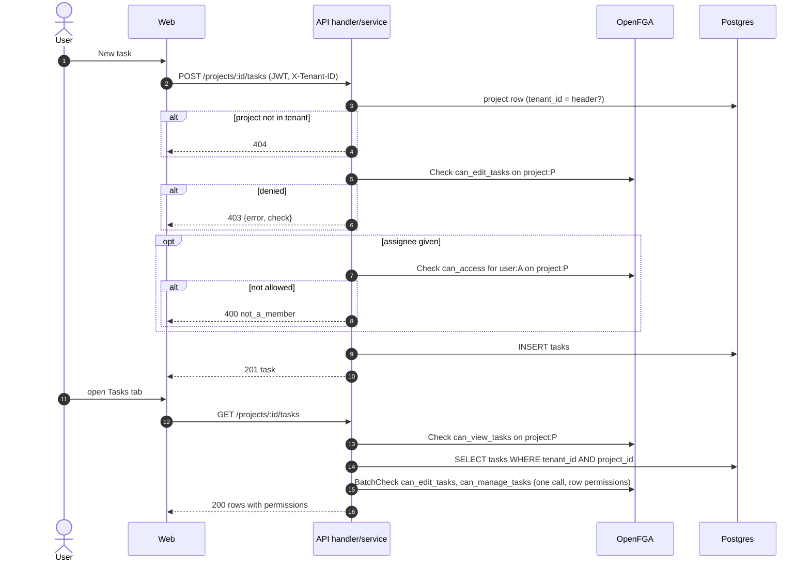
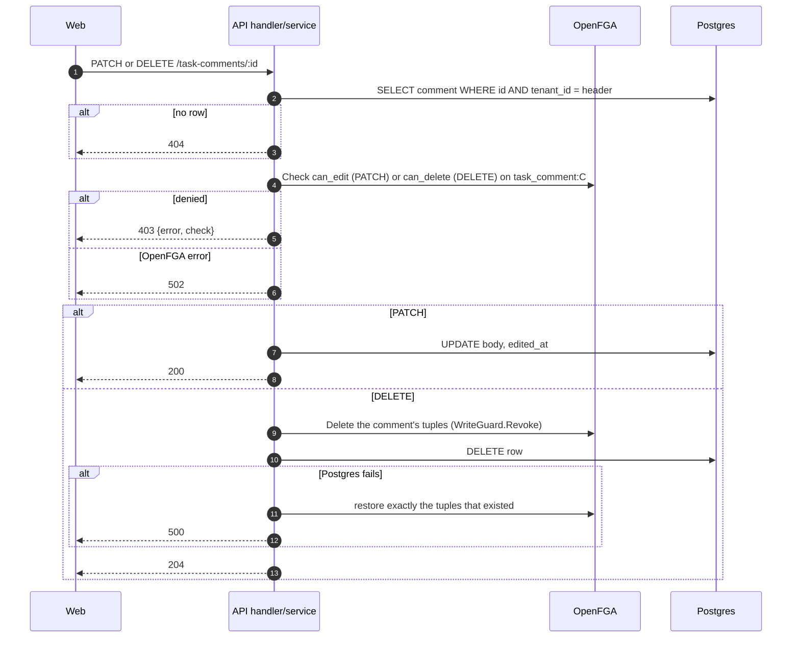
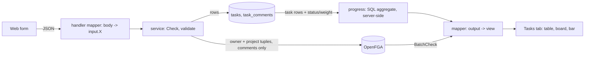

# System design: task-management

Input: `requirements.md` (approved). Tasks and comments are two new, fully separate domains (`task`, `task_comment`) in every Go layer; no engine/agent change.

## Components changed
| Component | Change (create / update / delete) | Why |
| --- | --- | --- |
| api `domain/model`, `domain/gateway` | create `task.go`, `task_comment.go`, `*_params.go`, `TaskGateway`, `TaskCommentGateway`, `TaskRelationGateway`, `TaskCommentRelationGateway`; update `product.go` (+`tasks`), `authz.go` (relation names) | business data and data-access interfaces |
| api `usecase` (+ `input`, `output`) | create per operation: `TaskCreator`, `TaskGetter`, `TaskLister`, `TaskUpdater`, `TaskDeleter`, `TaskProgressGetter`, `TaskAssigneeLister`, `TaskCommentCreator`, `TaskCommentLister`, `TaskCommentUpdater`, `TaskCommentDeleter` | one interface per operation |
| api `service` | create one file per operation + `task_helper.go`, `task_output.go`, `task_comment_output.go`; update `product_setter` (accepts `tasks`) | business logic: Check, validate, write ordering |
| api `infrastructure/postgres` | create `task_repo.go`, `task_comment_repo.go` (literal table names); update product repo (`tasks`) | storage |
| api `infrastructure/fga` | create `task_comment_relations.go` (pure builders: `project` + `owner` tuples); update `product_relations.go` (`tasks_enabled` wildcard) | tuples live only here |
| api `handler/http` (+ `mapper`) | create `task_handler.go`, `task_comment_handler.go`, `mapper/task_mapper.go`, `mapper/task_comment_mapper.go`; update `permission_handler` / inspector whitelist | routes and JSON views |
| api `cmd/api/wire.go`, `cmd/seed`, `internal/seed/world.go` | update | wiring; demo tasks, comments, `tasks_enabled` and the comment tuples (ids only in `world.go`) |
| api `migrations` | create one additive migration (design in `db-design.md`) | tables `tasks`, `task_comments`, product value |
| web | create `components/ProjectTasks.tsx` (table/board, progress, filters), `components/TaskDrawer.tsx` (fields + comments); update `ProjectDetail.tsx` (Tasks tab, `?tab=tasks`), `TenantDetail.tsx` (product row), `permissions.tsx` (`FEATURES`, `ACTIONS`), `api.ts`, `Inspector.tsx` | UI per requirements |
| blueprint-engine, agent | none | no geometry or LLM |
| OpenFGA model / tuples | update `api/fga/model.fga` and the DSL block in `docs/authorization-model.md` (equal); new type `task_comment`; tuples below | decisions stay in OpenFGA |
| infra / 3rd party | none | |

## Sequence diagram

Create a task (assignee set), then list.



Add a comment (grant: Postgres first, then OpenFGA, compensate Postgres). The task row is locked (`SELECT ... FOR UPDATE`) in the transaction, so the 50-comment cap and a concurrent task delete are serialized.

```mermaid
sequenceDiagram
    autonumber
    participant Web
    participant API as API handler/service
    participant FGA as OpenFGA
    participant PG as Postgres
    Web->>API: POST /tasks/:id/comments {body}
    API->>PG: BEGIN; SELECT task WHERE id AND tenant_id = header FOR UPDATE
    alt no row (missing or other tenant)
        API-->>Web: 404
    end
    API->>FGA: Check can_view_tasks on project:P
    alt denied
        API-->>Web: 403 {error, check}
    else OpenFGA error
        API-->>Web: 502
    end
    API->>PG: count comments
    alt 50 or more
        API-->>Web: 409 comment_limit
    end
    API->>PG: INSERT task_comments
    API->>FGA: Write task_comment:C#project@project:P, #owner@user:U
    alt FGA write fails
        API->>PG: ROLLBACK (compensate)
        API-->>Web: 502
    end
    API->>PG: COMMIT
    API-->>Web: 201 comment
```

Edit or delete a comment (revoke: OpenFGA delete first, then Postgres; on a Postgres failure restore exactly the tuples that existed).



Delete a task (same revoke ordering; the task row is locked so no comment can be added between the tuple delete and the row delete, and an add that waited finds no task: 404).

```mermaid
sequenceDiagram
    autonumber
    participant Web
    participant API as API handler/service
    participant FGA as OpenFGA
    participant PG as Postgres
    Web->>API: DELETE /tasks/:id
    API->>PG: BEGIN; SELECT task WHERE id AND tenant_id = header FOR UPDATE
    alt no row
        API-->>Web: 404
    end
    API->>FGA: Check can_edit_tasks on project:P
    alt denied
        API-->>Web: 403 {error, check}
    end
    API->>PG: SELECT comment ids of the task
    API->>FGA: Delete their tuples, one atomic write (<= 100 keys)
    API->>PG: DELETE task (comments cascade); COMMIT
    alt Postgres fails
        API->>FGA: restore exactly the tuples that existed
        API-->>Web: 500
    end
    API-->>Web: 204
```

## Data flow

Progress = SUM(weight) FILTER (status = 'completed') / SUM(weight) and counts by status, one `GROUP BY status` query scoped by `tenant_id AND project_id`. No tuple is written for tasks themselves.

## Authorization

Tasks are authorized on the **project**; there is no per-task object (no private tasks, no sharing). Only comments get an object, so "edit/delete your own comment" is an OpenFGA decision, not a service branch on the author.

Model additions (allow-only, no `but not`):

```fga
type tenant
  relations
    define tasks_enabled: [user:*]

type project
  relations
    define can_view_tasks: can_access and tasks_enabled from tenant
    define can_edit_tasks: can_contribute and tasks_enabled from tenant
    define can_manage_tasks: (internal_admin from tenant or internal_admin or grant_manage from tenant or grant_manage) and can_contribute and tasks_enabled from tenant

type task_comment
  relations
    define project: [project]
    define owner: [user]
    define can_edit: owner and can_view_tasks from project
    define can_delete: (owner or can_manage_tasks from project) and can_view_tasks from project
```

These are additions inside the existing `tenant` and `project` types (the `relations` line already exists there); the plan pastes the full resulting model into `model.fga` and the docs block, which must stay equal.

`can_manage_tasks` mirrors the content `can_manage` (owner of nothing here: internal admin, or a custom role with `manage`). `can_contribute` already carries internal members, external admins in the project and custom roles with contribute/edit/manage, as the requirements decided; external users and non-members are false. `can_access` carries project membership and `can_read_tenant`, so stale grants on removed members fail closed.

| Action | Check | Object |
| --- | --- | --- |
| List tasks, progress, comments (`[]`/zero progress when denied), get a task (404 when denied), add a comment (403) | `can_view_tasks` | the task's project |
| List assignee candidates (`[]` when denied) | `can_edit_tasks` (the only people who assign), then `can_access` BatchCheck on the candidates | project |
| Create, update or delete a task | `can_edit_tasks` (403) | project |
| Assignee on create, and on update only when `assignee_id` changes (an unrelated edit never fails because an old assignee lost access) | `can_access` with the assignee as user; else 400 `not_a_member` | project |
| Edit a comment | `can_edit` | task_comment |
| Delete a comment | `can_delete` (author, or `can_manage_tasks`) | task_comment |
| Toggle the product | `can_manage_platform` (existing set-product path; `:product` accepts `tasks`) | platform:main |

Tuples: `tenant:T#tasks_enabled@user:*` (product); per comment `task_comment:C#project@project:P`, `task_comment:C#owner@user:U`. Tasks write no tuples.

Invariants touched and kept: every action is allowed only after its Check; the list is scoped by `tenant_id AND project_id` in SQL after the project Check, never a whole-tenant select filtered in Go (a project-wide list has no per-object variation, so ListObjects adds nothing); the tenant comes from `X-Tenant-ID` and the project/task row's `tenant_id` must equal it (404 otherwise); write ordering as in the diagrams; the assignee's affiliation is never branched on, only the `can_access` Check; the model stays allow-only; "platform OR tenant" is not needed (platform admins reach tasks only by toggling the product). A platform admin who is not a project member gets no task access, same as content.

Comment cap: 50 per task (409 `comment_limit`) keeps a task delete within the 100-key atomic write; chunking is not allowed outside the seed. The cap is enforced under a `FOR UPDATE` lock on the task row, held by comment create and by task delete, so two concurrent adds cannot pass the count together and an add cannot land between the tuple delete and the row delete.

Inspector: only project relations (the new `can_*_tasks`, `tasks_enabled`) are inspectable. `task_comment` is not; it has no `tenant` relation and the inspector derives the tenant from the object.

## API contract
All routes need `X-Tenant-ID`; JSON snake_case, RFC3339 timestamps, dates `YYYY-MM-DD`. Per `docs/http-api.md` conventions.

- `GET /api/v1/projects/:id/tasks` -> 200 `[Task]`, each with `permissions {can_edit_tasks, can_manage_tasks}` (one BatchCheck) and `comment_count`. Check `can_view_tasks`; denied returns `[]` (collection convention, AC4).
- `GET /api/v1/projects/:id/task-progress` -> 200 `{total, weight_total, weight_done, percent, counts:{not_started,in_progress,completed,blocked}}`. `percent` 0 when there are no tasks; denied returns the zero progress. `can_view_tasks`.
- `GET /api/v1/projects/:id/task-assignees` -> `[{user_id, name}]`. Gated by `can_edit_tasks` (the `share-candidates` pattern), `[]` when denied. Computed as one bounded Postgres read of the tenant's member rows (`WHERE tenant_id = $1`, never filtered by role or affiliation) followed by `can_access` BatchChecks on the project (read-only, batched to the BatchCheck limit); only those allowed are returned. No email, no role. A convenience list; every write re-Checks.
- `POST /api/v1/projects/:id/tasks` body `{title, description?, assignee_id?, planned_start?, planned_end?, actual_start?, actual_end?, status?, weight?}` -> 201 `Task`. 400 `validation` (title empty or > 200, description > 10000, status unknown, weight <= 0 or > 2 decimals, an end before its start), 400 `not_a_member`; 403 with `check`.
- `GET /api/v1/tasks/:id` -> `Task` (404 when denied). `PATCH /api/v1/tasks/:id` partial body (field absent = unchanged, `null` clears an optional field); same validation; `can_edit_tasks`. `DELETE /api/v1/tasks/:id` -> 204.
- `GET /api/v1/tasks/:id/comments` (`[]` when denied) -> `[{id, task_id, author_id, author_name, body, created_at, edited_at?, permissions {can_edit, can_delete}}]` oldest first, one BatchCheck; `can_view_tasks`.
- `POST /api/v1/tasks/:id/comments` body `{body}` (1..4000) -> 201; 409 `comment_limit`. `PATCH /api/v1/task-comments/:id` body `{body}`; `DELETE /api/v1/task-comments/:id` -> 204. A missing comment, or one of another tenant, is 404; denied 403 with `check`.
- `PUT /api/v1/tenants/:id/products/tasks` (existing route, new value). `/me/permissions` and the inspector whitelist add `can_view_tasks`, `can_edit_tasks`, `can_manage_tasks`, `tasks_enabled`.

`assignee_name` is shown to every viewer, external users included, on purpose (a name only, no email); a person sees who owns the work.

`Task` = `{id, project_id, title, description?, assignee_id?, assignee_name?, planned_start?, planned_end?, actual_start?, actual_end?, status, weight, created_by, created_at, updated_at, comment_count, permissions}`.

## Docs to update in the same change
`docs/authorization-model.md` (DSL block + bullet; `api/fga/model.fga` equal), `docs/tuple-catalog.md`, `docs/decision-catalog.md`, `docs/http-api.md` (routes, the `:product` list at line 107, the whitelisted relations at line 264), `docs/database-schema.md` (incl. the `tenant_products` CHECK), `docs/seed-data.md`, `docs/web-ui.md`, `docs/testing.md`, `api/ARCHITECTURE.md`, `web/ARCHITECTURE.md`, `ARCHITECTURE.md` (domains list), `CLAUDE.md` (domain list line), `README.md` (click-script step), `docs/harness/progress.md`.

## Risks and alternatives rejected
- **Per-task OpenFGA object** (ListObjects, `owner`, shares): rejected, more tuples and writes for no per-task variation; the requirements have no private or shared tasks. Revisit if per-task visibility arrives.
- **Own-comment rule in the service** (compare author id): rejected, it would put an allow/deny decision outside OpenFGA. Cost: two tuples per comment and the 50-comment cap.
- **Reusing `can_create_blueprint`-style product coupling on `can_contribute`**: rejected, tasks need their own `tasks_enabled`.
- A project's tasks are unbounded (no pagination, a stated non-goal); the page loads them all. Acceptable for the demo.
- A comment author who loses project access can no longer see their comments (`can_view_tasks` fails closed); rows remain.
