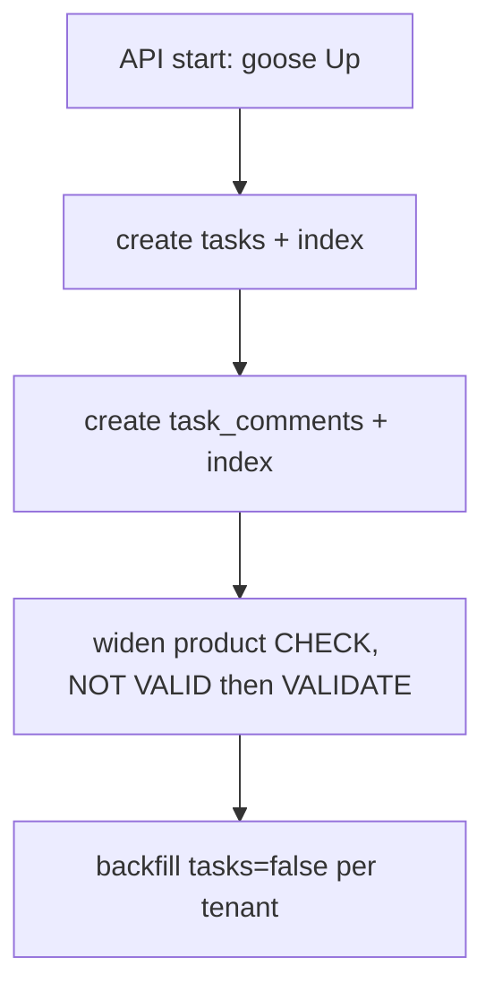

# Task T1: migration 00012_tasks.sql

Feature: task-management | Plan row: T1 | Deployable: api | Endpoint: none (schema) | Est: 3 h
Status: reviewed
Parent docs read: requirements ok, system-design n/a (no endpoint), db-design all sections (sections 4, 8, 10), plan row T1

## 1. Task
Add the schema the tasks feature stores in: tables `tasks` and `task_comments` and the `tasks` product value, exactly as `db-design.md` section 4 and 8. Nothing reads or writes the tables yet. Done when: `api/migrations/00012_tasks.sql` applies and rolls back cleanly; `Truncate` lists the new tables; `docs/database-schema.md` is updated; `make check` and `make verify-live` are green; the previous build (`main` at 900d203) runs on the migrated DB with the baselines unchanged.

## 2. Business logic
No runtime logic. Steps of the migration (Up):
1. `CREATE TABLE tasks` (composite FK to `projects (id, tenant_id)`, CHECKs for title, description, status, weight, date ranges) and `tasks_tenant_project_idx`.
2. `CREATE TABLE task_comments` (FK to `tasks` ON DELETE CASCADE) and `task_comments_task_created_idx`.
3. `SET LOCAL lock_timeout = '5s'`, widen `tenant_products_product_check` to add `'tasks'` (`NOT VALID`, then `VALIDATE`; the DROP carries `-- force-allow-breaking`, same as 00006), backfill one `('tasks', false)` row per tenant (`ON CONFLICT DO NOTHING`).

Down: drop `task_comments`, `tasks`, delete `tenant_products` rows with `product='tasks'`, restore the three-value CHECK. Loses all tasks and comments (demo data).

### TLA+ model
`n/a: additive DDL with no state machine, ordering across stores, or concurrency; the one lock-sensitive statement is bounded by lock_timeout.`

## 3. Impact
| Endpoint / feature | Table / caller | Change | Must stay the same | Proof |
| --- | --- | --- | --- | --- |
| all existing routes | all | none | status and JSON shape per step | both smoke-replay scripts diffed against `docs/harness/baselines/task-management/` |
| `GET /tenants/:id/products`, web toggle row | `tenant_products` | one extra `tasks` row (enabled=false) per tenant | the three existing products and toggling them | previous build started on the migrated DB, smoke-replay, curl the list |
| tenant creation (old build) | `tenant_products` | none | inserts three rows, accepted by the widened CHECK | old build creates a tenant (smoke-replay-domains does) |
| `make seed` | `Truncate` | lists `task_comments, tasks` | seed completes | `make verify-live` |

## 4. Risk
- Merge safety (plan): additive, nothing reads the tables; rollback: run the Down migration first (loses demo tasks), then revert the PR.
- Data/locks: `ALTER TABLE tenant_products` takes ACCESS EXCLUSIVE on a tiny table, guarded by `lock_timeout`. Tenants made by the old build have no `tasks` row; handled by T3 (upsert, missing row = disabled), not here.
- Authz: none (no tuples, no model change). Concurrency: none.
- Out of scope: `ProductRepo.Set` upsert and the tenant repo's fourth row (T3), seed tasks and `docs/seed-data.md` (T15a), model (T2).

## 5. Tests
- Unit: none beyond `make check` (`scripts/check-migrations.sh`; the architecture tests).
- Integration: dry run Up and Down in a rolled-back transaction on the live schema and on the seeded DB (`BEGIN; ...; ROLLBACK;`), constraint probes (bad status, weight 0, end before start, comment over 4000 chars, cross-tenant project FK rejected, cascade from task to comments); EXPLAIN (ANALYZE, BUFFERS) for Q1-Q3 recorded for the T5/T8/T10 PR descriptions.
- E2E: previous build on the migrated DB: `make verify-live`, both smoke-replays identical to baselines, products list and toggle still work.
- Commands: `make check`, `make verify-live`, both smoke scripts.

## Questions answered (only what the parent docs did not)
- `docs/seed-data.md` is left to T15a (no seed data in T1), as the db-design lists it at build of the seed task.
- Commit: not requested; the diff is left uncommitted (including this contract) until you say so.
