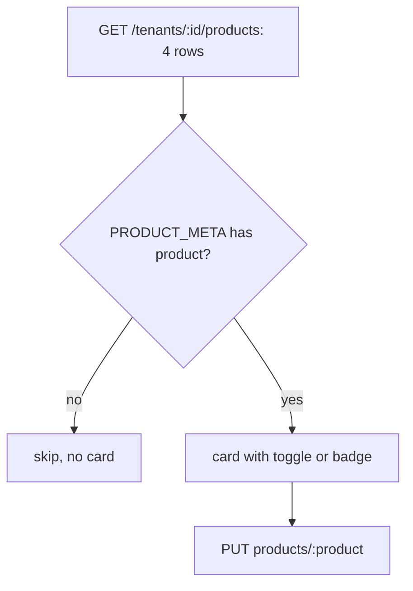

# Task T16: web foundation for tasks

Feature: task-management | Plan row: T16 | Deployable: web | Endpoint: Tenant page product row (no new route) | Est: 3 h
Status: implemented
Parent docs read: requirements ok, system-design "Authorization" + web row, plan rows T16/T17, T3 contract (the toggle), CLAUDE.md "Frontend permissions"

## 1. Task
Make the web know the `tasks` product so the Tenant page stops breaking on it, and prepare the permission mapping the Tasks tab (T17) will use. Since T1 backfilled a `tasks` row, `GET /tenants/:id/products` returns four products while `TenantDetail.tsx` only knows three (`PRODUCT_META[p.product]` is `undefined` for `tasks`, then `meta.icon` throws). Done when: on current `main` the crash is reproduced in a browser, after the change the Tenant page loads and the platform admin can toggle `tasks` for Acme; an unknown future product is skipped instead of crashing; `npm run build` is green; no Tasks tab renders anywhere.

## 2. Business logic
Changed code, UI only:
- S1: `api.ts` `Product.product` gains `"tasks"`; add `Task`, `TaskStatus`, `TaskPermissions` types matching the T4 JSON (no fetch calls yet: they arrive with the endpoints' consumers in T17+).
- S2: `TenantDetail.tsx`: `PRODUCT_META` gets `tasks` (label "Tasks", `IconChecklist`); the grid renders only products that have a meta entry (`products.filter`), so a product the web does not know yet is skipped, not a crash. The toggle uses the existing `PUT /tenants/:id/products/:product` and `act` helper.
- S3: `permissions.tsx` (the only place mapping permissions to UI): `FEATURES["nav.tasks"] = { all: ["tenant:can_read_tenant", "tenant:tasks_enabled"] }` (project tab rule: membership AND product); `ObjectType` gains `task` and `comment`; `ACTIONS` gains `editTask` and `deleteTask` (task row `can_edit_tasks`) and `editComment` (`can_edit`) / `deleteComment` (`can_delete`) on comment rows; `PROJECT_ACTIONS` gains `createTask` (`can_edit_tasks`) and `addComment` (`can_view_tasks`) read from the project row's `permissions`. Components still never name a relation.
- S4: `Inspector.tsx`: tenant relations gain `tasks_enabled` (the API whitelist has it since T3); no project type exists in the Inspector, so the project `can_*_tasks` are not added.
- S5: nothing renders the Tasks tab, no menu entry, no route; behavior for documents, photos and blueprints is unchanged.

### TLA+ model
`n/a: presentational change, no state machine, ordering across stores or concurrency.`

## 3. Impact
| Endpoint / RPC / page / feature | Table / caller | Change | Must stay the same | Proof |
| --- | --- | --- | --- | --- |
| Tenant page `/tenants/:id` | `GET /tenants/:id/products` | shows a Tasks card (toggle for platform admin, badge for tenant admin); unknown products skipped | Documents, Photos, Blueprints cards and toggles | browser: before (crash reproduced on `main`), after (page loads, toggle Acme `tasks` on and off, reload keeps state) |
| Inspector page | `POST /authz/check` | `tasks_enabled` offered for a tenant object | other relations | browser: tenant object, relation `tasks_enabled` answers |
| every other page | none | none | no menu or route change | `npm run build`; click Documents/Photos/Blueprints tabs of a project |

## 4. Risk
- Merge safety (plan): tab not rendered, only a toggle row; rollback: revert the PR.
- Authorization: hiding is UX only; the toggle stays platform-only on the server (403 for tenant admin, verified in T3). `permissions.tsx` is the single mapping; no role/affiliation string used.
- Compatibility: works with the API before and after T3 (`tasks` row exists since T1); unknown products are skipped so a later product cannot crash the page again.
- Out of scope: Tasks tab, table, drawer, api calls (T17+), `docs/web-ui.md` page text beyond the products sentence.

## 5. Tests
- No web test runner exists (none added: not a goal of this task). Proof is `npm run build` (`tsc --noEmit` + vite) and the browser walk above.
- E2E (from plan): toggle `tasks` for Acme as ada and see it in the products list; as bob (tenant admin) see the badge, no switch; Globex/other cards unchanged.
- Commands: `make check` (includes the web build), `cd web && npm run build`.

## Questions answered (only what the parent docs did not)
Added to the plan row (agreed in chat): the skip-unknown-products guard. `api.ts` calls are deferred to T17+ (no endpoint is consumed yet).
