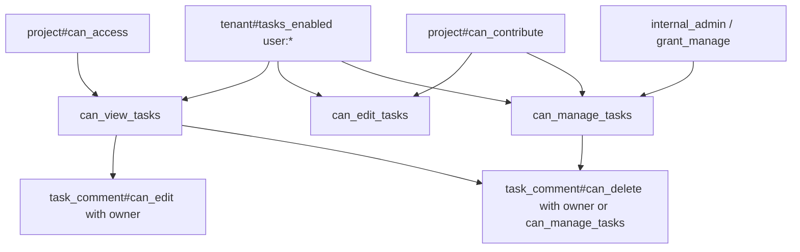

# Task T2: OpenFGA model for tasks

Feature: task-management | Plan row: T2 | Deployable: api | Endpoint: none (authorization model) | Est: 4 h
Status: implemented
Parent docs read: requirements ok (AC2-5, access decision), system-design "Authorization" section, db-design n/a (no data), plan row T2

## 1. Task
Add the superset OpenFGA model the tasks feature needs, exactly as `system-design.md` "Authorization": `tenant#tasks_enabled`, `project#can_view_tasks / can_edit_tasks / can_manage_tasks`, new type `task_comment`. Nothing in Go uses it yet; only the model changes. Done when: `api/fga/model.fga` equals the DSL block in `docs/authorization-model.md`; `docs/tuple-catalog.md` and `docs/decision-catalog.md` list the new tuples and Checks; a new integration test proves the relation truth table on a scratch store; `make check` and `make verify-live` are green after a reseed.

## 2. Business logic
Model only, no runtime flow. Relations added (allow-only, no `but not`, no conditions):

```fga
type tenant
    define tasks_enabled: [user:*]

type project
    define can_view_tasks: can_access and tasks_enabled from tenant
    define can_edit_tasks: can_contribute and tasks_enabled from tenant
    define can_manage_tasks: (internal_admin from tenant or internal_admin or grant_manage from tenant or grant_manage) and can_contribute and tasks_enabled from tenant

type task_comment
  relations
    define project: [project]
    define owner: [user]
    define can_edit: owner and can_view_tasks from project
    define can_delete: (owner or can_manage_tasks from project) and can_view_tasks from project
```

Truth table to prove (Acme has the product on in the scratch store; Globex off):
- `can_view_tasks`: every project member who passes `can_access` (internal members, project external users and admins, custom-role members); false for non-members, platform admin, removed member (stale grant), product off.
- `can_edit_tasks`: internal members, project external admin, custom role with contribute/edit/manage; false for external users, non-members, product off.
- `can_manage_tasks`: internal admin (tenant or project), custom role with `grant_manage`; false for plain internal user and external admin.
- `task_comment`: owner edits and deletes own; a `can_manage_tasks` holder deletes (not edits) anyone's; others false; owner who lost project access (member removed) false (fail closed).

What must stay identical: every existing relation text, so every existing Check and ListObjects result is unchanged; `make seed` still works (it writes the newest model; the seed writes no new tuples in T2).



### TLA+ model
`n/a: a static, allow-only relation model; no state machine, write ordering or concurrency. The truth table is checked by the integration test against a real store.`

## 3. Impact
| Endpoint / feature | Table / caller | Change | Must stay the same | Proof |
| --- | --- | --- | --- | --- |
| all existing routes and Checks | OpenFGA store | newer model version (superset) | every existing decision | `TestModelAgainstSeed`, `TestBlueprintAccess` and the other fga integration tests unchanged and green on the new model |
| `make seed` | store | writes the new model | seed completes | `make verify-live` after reseed |
| API on a store without the new version | none | new relations ignored by old API | n/a | rollback note below |
| docs | `model.fga` vs docs block | equal | sync script | `make check` docs/model sync |

## 4. Risk
- Merge safety (plan): superset model, no code uses it; rollback: revert the PR, then reseed (`make seed`) so the store has the previous model. A non-demo store needs the new model version written before the new API starts (the API opens the newest; T3 onward needs it).
- Authorization: this is the decision source for the whole feature; `authz-reviewer` runs on the diff. Invariants kept: allow-only, `can_*` all intersect `tasks_enabled`, content-style fail-closed via `can_access`, platform admin gets nothing without membership.
- `can_manage_tasks` wording follows the approved design (internal admin at tenant or project, or `grant_manage`), intersected with `can_contribute`. No change proposed.
- Out of scope: Go code, `permission_handler` / inspector whitelist and `model/authz.go` names (T3), tuple builders (T10), seed data (T15a).

## 5. Tests
- Unit: `model_dsl_test.go` still parses the model; add assertions that the new types and relations exist in the parsed model.
- Integration (`//go:build integration`, new `task_integration_test.go`, scratch store `fga-demo-task-test`): the truth table above using seed users (Bob internal admin Acme, Cara internal user / Annex admin, Dan external user, Fay external admin in Tower, Eve Globex, Ada platform), custom roles via role tuples, product off, member removal, comment owner/manager rows.
- E2E (plan): `make verify-live` after reseed + the new model test; `authz-reviewer` on the model.
- Commands: `make check`, `make verify-live` (RESETS data; restart the API after).

## Questions answered (only what the parent docs did not)
None; the design fixes the model text.
