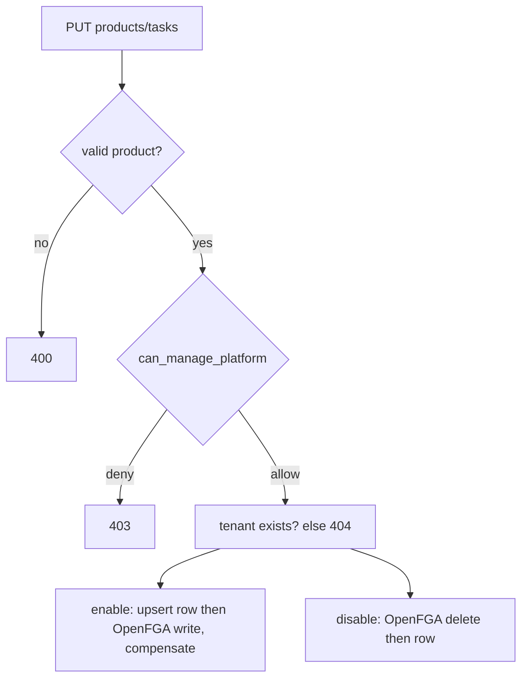

# Task T3: tasks product toggle

Feature: task-management | Plan row: T3 | Deployable: api | Endpoint: `PUT /tenants/:id/products/tasks` (+ list) | Est: 5 h
Status: implemented
Parent docs read: requirements ok, system-design "Authorization" + "API contract" (last bullet), db-design (tenant_products upsert), plan row T3, T1 and T2 contracts

## 1. Task
Make `tasks` a fourth product a platform admin can switch on or off per tenant, and expose the new relations to `/me/permissions` and the inspector. No task endpoint exists yet; this only creates the feature switch. Done when: `PUT /tenants/:id/products/tasks` works for a platform admin (writes/deletes `tenant:T#tasks_enabled@user:*`), tenant admins get 403, a tenant that lacks the `tasks` row (made by the old build) can still be toggled, new tenants get four product rows, `/me/permissions` and the inspector report `tasks_enabled`, `can_view_tasks`, `can_edit_tasks`, `can_manage_tasks`; `make check` and `make verify-live` green.

## 2. Business logic
Changed code, same flow as the existing set-product command (`product_setter.go`):
1. `ValidProduct`: `AllProducts` gains `tasks` (400 `validation` otherwise; message now lists all four).
2. `RequirePlatform` (`can_manage_platform`), 403. Tenant exists (404).
3. Enable: `ProductRepo.Set` (Postgres) then `WriteGuard.Grant` of the wildcard (compensate Postgres). Disable: `WriteGuard.Revoke` (OpenFGA delete, then Postgres; restore the tuple if it existed). Unchanged for the other products.
4. Before -> after in `ProductRepo.Set`: today `SELECT ... FOR UPDATE` fails with no-rows when the row is missing. After: `INSERT (tenant_id, product, enabled=false) ON CONFLICT DO NOTHING`, then the same `SELECT ... FOR UPDATE` and `UPDATE`, in one transaction; `prev` is false for a missing row. Existing rows behave identically.
5. `GET /tenants/:id/products` lists rows as today; a missing row stays absent (T1 backfilled all current tenants; a tenant made later by an old build has three rows until its first toggle).
6. Tenant creation inserts four rows (`documents`, `photos`, `blueprints`, `tasks`, all false).
7. `ProductRelations.Enabled` already builds `<product>_enabled`; no change beyond a unit test row for `tasks`.
8. `model.PermissionRelations`: tenant += `tasks_enabled`; project += `can_view_tasks`, `can_edit_tasks`, `can_manage_tasks`. `Authorizer.Permissions` and the inspector read this map, so both pick them up. Consequence: the project `permissions` object in existing responses gains these keys, and `/me/permissions` for a tenant gains `tasks_enabled`.

### TLA+ model
`n/a: same write order and compensation as the existing set-product command, which is reused unchanged; the only new step is an idempotent upsert inside one transaction.`

## 3. Impact
| Endpoint / feature | Table / caller | Change | Must stay the same | Proof |
| --- | --- | --- | --- | --- |
| `PUT /tenants/:id/products/{documents,photos,blueprints}` | `tenant_products`, OpenFGA | none | status, body, tuple | smoke-replay and replay-domains diff |
| `PUT /tenants/:id/products/tasks` | same | new value accepted | platform-only, 403 for tenant admin | HTTP walk below |
| `GET /tenants/:id/products` | `tenant_products` | lists `tasks` (already added by T1) | the other rows | replay diff |
| `GET /me/permissions`, project `permissions` objects, `POST /authz/check` | model/authz.go | extra keys / relations allowed | existing keys and values | replay diff shows only added keys |
| `POST /tenants` | `tenant_products` | four rows instead of three | tenant creation | replay-domains |
| web Tenant page | `GET products` | see Risk (pre-existing, from T1) | n/a | n/a |

## 4. Risk
- Merge safety (plan): additive; the three existing products unchanged; toggling creates the feature switch only (no endpoint behind it). Rollback: revert the PR (a `tasks_enabled` tuple left in the store is harmless).
- Authorization: toggle stays platform-only (`can_manage_platform`); tenant admins still only see status. Inspector derives tenant from the object as before; `task_comment` is not whitelisted. `authz-reviewer` runs.
- Compatibility: old build ignores the `tasks` row's relation names; the widened CHECK from T1 already accepts it.
- **Found while reading: the web Tenant page indexes `PRODUCT_META[p.product]` (`web/src/pages/TenantDetail.tsx:138`) and `Product.product` is a closed type (`web/src/api.ts:6`). Since T1 backfilled a `tasks` row, that page already dereferences `undefined.icon` for every tenant. It is a web fix (second deployable), so it is out of T3; the plan's T16 covers the toggle row, but the crash exists now. Proposal: ship a one-line web guard as its own small PR before or with T3.**
- Concurrency: the upsert plus `FOR UPDATE` in one transaction serializes two toggles on the same row; `ON CONFLICT DO NOTHING` makes the first-toggle race safe.
- Seed: `world.go` used `model.AllProducts` for Acme, so adding `tasks` would have switched it on in the demo; the Acme list is now explicit (documents, photos, blueprints) so seed output is unchanged until T15a (change made during implementation).
- Out of scope: web, task endpoints, seed (T15a), `docs/web-ui.md`.

## 5. Tests
- Unit: `model.ValidProduct("tasks")` true and a bogus value false; `ProductRelations.Enabled(t,"tasks")` is `tenant:t#tasks_enabled@user:*`; `PermissionRelations` contains the new names and `IsPermissionRelation` accepts them per type, rejects `task_comment`; `product_setter` service test (fakes): validation message, non-platform 403, tuple written on enable and deleted on disable.
- Integration (`-tags=integration`, real Postgres): `ProductRepo.Set` on a missing row inserts then sets (prev false), on an existing row updates, twice in a row is idempotent; tenant create inserts four rows.
- E2E through HTTP (API running): platform admin enables then disables `tasks` for Globex (list shows it, `/me/permissions` shows `tasks_enabled`), tenant admin 403, a tenant whose `tasks` row was deleted by hand toggles fine; both smoke-replay scripts diffed against `docs/harness/baselines/task-management/` (only added permission keys allowed).
- Commands: `make check`, `make verify-live`, `scripts/smoke-replay.sh`, `scripts/smoke-replay-domains.sh`.

## Questions answered (only what the parent docs did not)
None. Open for the user: the web guard above (separate PR, or fold into T16), and commit after review?
