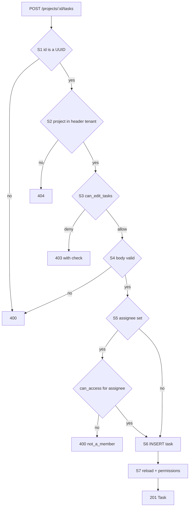

# Task T4: create a task

Feature: task-management | Plan row: T4 | Deployable: api | Endpoint: `POST /api/v1/projects/:id/tasks` | Est: 6 h
Status: implemented
Parent docs read: requirements ok (AC2, AC3, AC5), system-design "Create a task" sequence + "Authorization" + "API contract", db-design sections 4 (`tasks`) and Q4/Q6, plan row T4, T1-T3 contracts

## 1. Task
Add the first task endpoint: a contributor creates a task in a project. It introduces the `task` domain in every Go layer (model, gateway, usecase + input/output, service, postgres repo, handler + mapper, wiring). The product is off for every tenant by default, so the route answers 403 until a platform admin enables `tasks`. Done when: the HTTP matrix in section 5 passes; `make check` and `make verify-live` are green; both smoke-replays are identical to the T0 baselines; docs and the domain lists name `task`.

## 2. Business logic
**Change during implementation (requested by the user):** field validation (S4) moved from the service to the handler layer (`mapper.TaskCreatorInput`, request body -> `input.TaskCreator`, typed and already valid). Consequences: a 400 `validation` is now answered before the project load and the Check (an invalid body gets 400 even for a caller who would get 403 or 404); the service keeps defaults (status, weight), the project load, `can_edit_tasks`, the assignee `can_access` Check and the write; the DB CHECKs still back the rules (S8). `service/task_helper.go` is gone. Departs from the CLAUDE.md line "Services read as business logic: validate, Check ...", for this domain at the user's request.

New code, whole flow. Step IDs are append-only.

- S1: parse `:id` as a UUID (400 `validation`); the tenant comes from `X-Tenant-ID` (middleware).
- S2: load the project (`ProjectGateway.Get`); missing or `tenant_id` != header tenant -> 404.
- S3 (order now after S4, see the change note above): `Authorizer.Require(actor, can_edit_tasks, project)` -> 403 `{error, check{relation, object}}`. Nothing is read or written before this except S1-S2.
- S4: validate the body (400 `validation`): title trimmed 1..200 chars; description <= 10000 chars (absent = empty); status in `not_started|in_progress|completed|blocked` (absent = `not_started`); weight > 0, at most 2 decimals, <= 999999.99 (absent = 1); dates `YYYY-MM-DD`; `planned_end` >= `planned_start` and `actual_end` >= `actual_start` when both are present; `assignee_id` a UUID.
- S5: when `assignee_id` is set: `Authorizer.Check(user = assignee, can_access, project)`; false -> 400 `not_a_member`. Never reads the assignee's role or affiliation.
- S6: `TaskGateway.Create` inserts one row (`created_by` = actor, new id from `IDGenerator`): one SQL statement, no tuples, no second store.
- S7: reload the row (`TaskGateway.Get(tenant, id)`, Q4 with `LEFT JOIN users` for `assignee_name` and a comment count) and `Authorizer.Permissions` on the project for the row's `permissions {can_edit_tasks, can_manage_tasks}`; respond 201 `Task`.
- S8: a database CHECK or FK failure at S6 maps to 400/404 through `mapErr` (defence in depth; S4 already prevents it).

### TLA+ model
`n/a: one INSERT in one statement, no tuples, no second store, no state machine, no unique key to race on; two concurrent creates make two tasks, which is correct.`

Atomicity map:
| Action | Code unit | Step |
| --- | --- | --- |
| insert the task row | one SQL INSERT | S6 |

Guard map:
| Action | Guard and where it lives |
| --- | --- |
| insert | `Require can_edit_tasks` in the service (S3), then validation (S4), then assignee Check (S5); the DB CHECKs and composite FK `(project_id, tenant_id)` back S4 |

Invariant map (no TLA+ invariants; the rules that must hold):
| Rule | Test (name) |
| --- | --- |
| no row is written when the Check fails | `TestTaskCreatorDeniedWritesNothing` (fake gateway counts calls) |
| invalid body never reaches the usecase | `TestTaskCreatorInputRejectsInvalidBodies` (mapper) |
| assignee decided by `can_access` only | `TestTaskCreatorAssigneeNotAMember` |
| project of another tenant is 404 before any Check | `TestTaskCreatorOtherTenantProject` |

## 3. Impact
| Endpoint / feature | Table / caller | Change | Must stay the same | Proof |
| --- | --- | --- | --- | --- |
| `POST /projects/:id/tasks` | `tasks`, OpenFGA reads | new route | n/a | HTTP matrix |
| all existing routes | none | none (only a new route and new wiring) | status and JSON shape per step | both smoke-replays diffed against `docs/harness/baselines/task-management/` |
| `GET /projects/:id` and project routes | none | none | same path prefix, different method/suffix | replay-domains diff |
| web | none | none | product off, tab not built yet | n/a |

## 4. Risk
- Merge safety (plan): new route; with the product off for everyone it 403s; no existing path touched. Rollback: revert the PR (rows made while it was live stay in `tasks`, harmless).
- Authorization: `can_edit_tasks` on the project is the only gate (external users and non-members 403, other-tenant project 404). The assignee is decided by an OpenFGA `can_access` Check, never by `tenant_members.role/affiliation`. `authz-reviewer` runs.
- Data: composite FK keeps a task in its project's tenant; `created_by` is the JWT `sub`. Weight is a float64 in the Go model, validated to 2 decimals and stored as `numeric(8,2)`.
- Decision recorded: Check (403) comes before body validation (400), so a caller without access learns nothing about the validation rules.
- Out of scope: list/get/update/delete (T5-T8), progress, comments, web, seed (T15a).

## 5. Tests
- Unit (service, fakes): title/description/status/weight/dates validation table; defaults (status, weight 1); denied Check writes nothing (403 with check); assignee not a member (400) and a member passes; other-tenant project is 404 and never reaches the Check; Check happens before any gateway write. Handler/mapper: date format `YYYY-MM-DD`, field omission.
- Integration (real Postgres, `-tags=integration`): `TaskRepo.Create`/`Get` round trip, CHECK failures map to validation, cross-tenant project FK fails, assignee name join.
- E2E (HTTP, API running, product turned on for Acme through the T3 route): title-only 201; all fields 201; 400s (empty title, weight 0, end before start, unknown status); `not_a_member` (Eve, not an Acme member); Cara (internal) 201; Fay (external admin in Tower) 201; Dan (external user) 403; a project of another tenant 404; product off -> 403 for everyone. Both smoke-replays unchanged.
- Commands: `make check`, `make verify-live`, `scripts/smoke-replay.sh`, `scripts/smoke-replay-domains.sh`, `authz-reviewer`, `task-reviewer`.

## Questions answered (only what the parent docs did not)
Open for you: commit after review? (default: leave uncommitted until you ask.)
